# Hackathon Guide: Build a Live Weather Station with LoT

Welcome to the Coreflux Weather Station Hackathon! You will build an end-to-end IoT data pipeline and live dashboard that runs entirely inside a single **Coreflux Broker**.

You do not need any prior experience with Coreflux, MQTT, or LoT (Language of Things) — this guide explains each concept as you build it.

---

## Table of contents

1. [What you will build](#1-what-you-will-build)
2. [Key concepts](#2-key-concepts)
   - [Learn about Coreflux concepts (`index.html`)](#learn-about-coreflux-concepts-indexhtml)
3. [Step 1: Start the local environment](#3-step-1-start-the-local-environment)
4. [Step 2: Connect to the HUB](#4-step-2-connect-to-the-hub)
5. [Step 3: Configure variables and the heat limit (`00-setup`)](#5-step-3-configure-variables-and-the-heat-limit-00-setup)
6. [Step 4: Build the station (Labs 1–6)](#6-step-4-build-the-station-labs-16)
   - [Lab 1: Heartbeat (`01-heartbeat`)](#lab-1-heartbeat)
   - [Lab 2: Model and unit conversion (`02-model-processweather`)](#lab-2-model-and-unit-conversion)
   - [Lab 3: Fetch real weather (`03-campus-weather`)](#lab-3-fetch-real-weather)
   - [Lab 4: Heat alert, CSV history, and email (`04-heat-alert-history-email`)](#lab-4-heat-alert-csv-history-and-email)
   - [Lab 5: Protect the heat limit with a Rule (`05-rules`)](#lab-5-protect-the-heat-limit-with-a-rule)
   - [Lab 6: Build the live dashboard (`06-panel`)](#lab-6-build-the-live-dashboard)
7. [Stretch goals (`07-stretch`)](#7-stretch-goals-07-stretch)
8. [Troubleshooting & FAQ](#8-troubleshooting--faq)
9. [Optional: Using VS Code instead of the HUB](#9-optional-using-vs-code-instead-of-the-hub)
10. [Further reading](#10-further-reading)

---

## 1. What you will build

By the end of the 6 core labs, your broker will run this complete pipeline automatically:

```text
Open-Meteo Web API
       │  (Lab 3: CampusWeather Connector fetches JSON every 5 min or on poll)
       ▼
campus/weather/raw
       │  (Lab 2: ProcessWeather Action validates & converts °C→°F, km/h→mph)
       ▼
campus/weather/reading  ──┬──► Lab 4: WeatherHistory Connector ──► exports/campus-weather.csv
                          ├──► Lab 4: HeatAlert Action ──► HeatMail Connector ──► Mailpit Inbox
                          └──► Lab 6: CampusWeather Panel (Live Dashboard in HUB)
```

### How you will know everything works ("Done" checklist)

When you finish the labs, you can check all of this yourself in the HUB:

- **Data Viewer** shows the station's heartbeat, `ok`, refreshed every 5 seconds.
- When you ask the station for the weather, a new reading with the real weather for your site appears in **Data Viewer**.
- Every reading adds a line to `project/exports/campus-weather.csv` on your laptop.
- When you set the heat limit below the current temperature, the heat alert turns on and one email arrives in Mailpit (http://localhost:8025).
- The **Campus Weather** dashboard (**Dashboards** in the dock) shows the temperature in °C and °F, the wind and whether the heat alert is on.

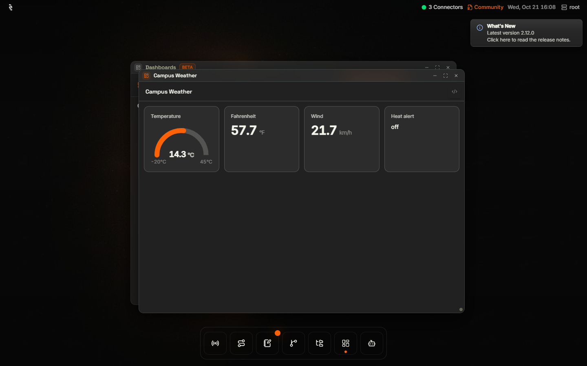
*The finished station in the HUB: the Campus Weather dashboard with live °C, °F, wind and the heat alert.*

---

## 2. Key concepts

Coreflux is an **MQTT broker** with a built-in programming language called **LoT (Language of Things)**. Instead of running separate servers or scripts to poll APIs, transform data, and send alerts, you deploy small building blocks directly into the broker.

| Term | What it means | Analogy |
|---|---|---|
| **Broker** | The central server that receives, processes, and routes messages. | The LEGO baseplate everything clicks onto. |
| **HUB** | The web interface (`http://localhost:3000`) where you write LoT code, watch live data, and view dashboards. | Your control room window into the broker. |
| **Topic** | A slash-separated address where messages are published, like `campus/weather/reading`. Any piece listening to that address receives the message. | A named mailbox or radio channel. |
| **Retained message** | A setting that tells the broker to remember the last message on a topic and hand it immediately to any new subscriber (or Action). | A sticky note left on the mailbox. |
| **Action** (`DEFINE ACTION`) | A rule of logic: *"When trigger X happens, do Y"* (for example, run every 5 seconds, or run whenever a message arrives on a topic). | A worker brick that does one job. |
| **Model** (`DEFINE MODEL`) | A schema that defines the exact fields and data types (`DOUBLE`, `STRING`, etc.) of a clean message. | A blueprint for a data record. |
| **Connector** (`DEFINE CONNECTOR`) | A bridge between the broker and an external system: a REST API, a CSV file, an email server, a PLC, or a database. | An antenna reaching outside the broker. |
| **Rule** (`DEFINE RULE`) | An access-control policy that decides which users or groups may publish or subscribe to specific topics. | A security guard on a topic. |
| **Panel** (`DEFINE PANEL`) | A live visual dashboard inside the HUB with gauges, value cards, and status indicators bound to topics. | The display screen on the front of the box. |

**Want to go deeper?** The [Coreflux documentation](https://docs.coreflux.org) covers everything this guide only touches:

- **Using the HUB:** [HUB overview](https://docs.coreflux.org/hub/overview) · [Using the HUB](https://docs.coreflux.org/latest/quick-start/using-hub) · [LoT Editor](https://docs.coreflux.org/hub/lot-editor) · [Data Viewer](https://docs.coreflux.org/hub/mqtt/data-viewer) · [Dashboards](https://docs.coreflux.org/hub/dashboards/overview) · [Broker Settings, Variables & Secrets](https://docs.coreflux.org/hub/system/configuration)
- **LoT syntax:** [Introduction to LoT](https://docs.coreflux.org/latest/lot-language/introduction) · [Actions](https://docs.coreflux.org/latest/lot-language/actions/syntax) · [Models](https://docs.coreflux.org/latest/lot-language/models/overview) · [Connectors](https://docs.coreflux.org/latest/lot-language/routes/overview) · [Rules](https://docs.coreflux.org/latest/lot-language/rules/syntax) · [Panels](https://docs.coreflux.org/latest/lot-language/panels/defining-panels) · [Things](https://docs.coreflux.org/latest/lot-language/things/overview)
- **The broker:** [Broker overview](https://docs.coreflux.org/latest/mqtt-broker/overview) · [Broker commands](https://docs.coreflux.org/latest/mqtt-broker/commands) · [Environment variables & secrets](https://docs.coreflux.org/latest/mqtt-broker/secrets-and-env)

### Learn about Coreflux concepts (`index.html`)

Optional, and you can come back to it at any time. [`index.html`](index.html) is an interactive, 11-slide visual overview of how all the pieces of the weather station fit together.

**To open it**, either:

- in the HUB, after [Step 2.3](#23-open-the-lesson-in-the-lot-editor): click **`index.html`** in the LoT Editor tree, or
- once you have downloaded this repository ([Step 1.2](#12-download-this-repository)): open `index.html` from your local copy in any browser.

Use the **Next** / **Back** buttons or your left/right arrow keys, and **Full screen** at the top right for a larger view.

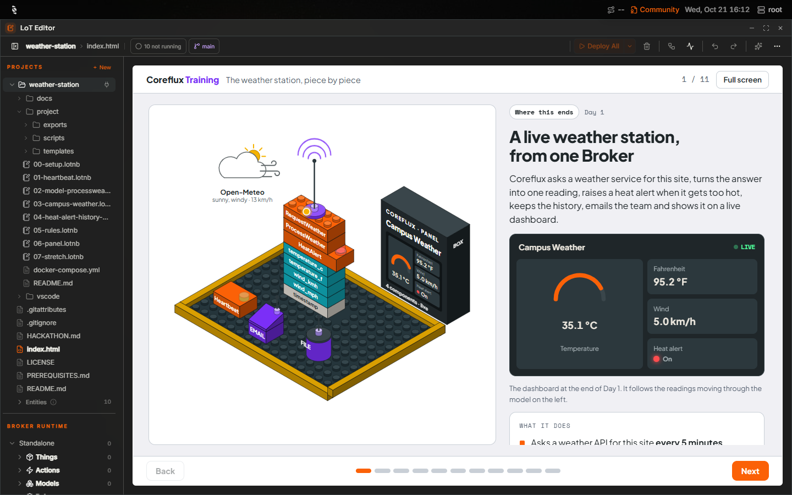
*The platform overview (`index.html`) in the LoT Editor, slide 1: the finished weather station.*

| Slide | Concept | How it is used in your weather station |
|---|---|---|
| **1. The finished weather station** | End result | A live dashboard fed by a single Coreflux Broker |
| **2. What Coreflux brings** | Get → Centralize → Process → Send | How a reading travels from the web API to the dashboard, CSV file, and email |
| **3. The Broker** | Broker | The baseplate everything runs on |
| **4. Topics** | Topics & Unified Namespace | Message addresses like `campus/weather/reading` |
| **5. Actions** | `DEFINE ACTION` | Event-driven or timed logic ("When X happens, do Y") |
| **6. Connectors** | `DEFINE CONNECTOR` | Bridges to Open-Meteo (REST), CSV (`FILE_STORAGE`), and Mailpit (`EMAIL`) |
| **7. Models** | `DEFINE MODEL` | The 5-field blueprint for `WeatherReading` |
| **8. Rules** | `DEFINE RULE` | Access control so only `operators` can change `config/heat_limit_c` |
| **9. Panels** | `DEFINE PANEL` | The live Campus Weather dashboard |
| **10. Put together** | Recap | All 7 pieces in the order you will deploy them |
| **11. One Thing** | `DEFINE THING` | Optional stretch goal (`07-stretch`) that bundles a station into a reusable template |

---

## 3. Step 1: Start the local environment

Everything runs on your laptop inside Docker containers — you do not need to install the Coreflux Broker or HUB manually.

### 1.1 Install Docker and check it works

Install Docker and Docker Compose, and confirm both version checks pass. The steps are in [PREREQUISITES.md](PREREQUISITES.md). Come back here when both checks print a version.

### 1.2 Download this repository

Open a terminal (Terminal on macOS and Linux, PowerShell on Windows) and get a copy of this repository on your computer (choose one):

- **With Git:**
  ```bash
  git clone https://github.com/CorefluxCommunity/weather-station-hackathon.git
  ```
- **Without Git:** On the GitHub page, click **Code → Download ZIP**, then unzip the downloaded file.

### 1.3 Start the containers

In your terminal, move into the `project/` folder and start Docker Compose:

```bash
cd weather-station-hackathon/project
docker compose up -d
docker compose wait load-project
```

*(If you downloaded the ZIP file, the folder name is `weather-station-hackathon-main/project`.)*

**What just happened?**
1. `docker compose up -d` started the **Coreflux Broker** (v2.22+), **Coreflux HUB** (v2.12+), and **Mailpit** (a local test email server).
2. `docker compose wait load-project` waited for a helper container to add this repository to the broker as a project named **`weather-station`**. Nothing is deployed yet: you open the notebooks in the HUB in [Step 2.3](#23-open-the-lesson-in-the-lot-editor) and deploy each piece yourself in the labs.

| Service | Where to open it | Credentials / Notes |
|---|---|---|
| **Coreflux HUB** | http://localhost:3000 | Pre-filled (`root` / `coreflux` on `mqtt://broker:1883`) |
| **Mailpit (test inbox)** | http://localhost:8025 | Catches emails sent by the broker in Lab 4 |
| **Broker MQTT port** | `localhost:1883` | Used if you connect from VS Code (`root` / `coreflux`) |
| **Broker health check** | http://localhost:9100/health | Shows `"status":"Healthy"` in your browser |

---

## 4. Step 2: Connect to the HUB

### 2.1 Connect to the broker

1. Open **http://localhost:3000** in your web browser.
2. You will see the **New Connection** screen. All fields are already filled in (*Weather station*, host `broker`, port `1883`, username `root`, password `coreflux`). Click **Connect**.

   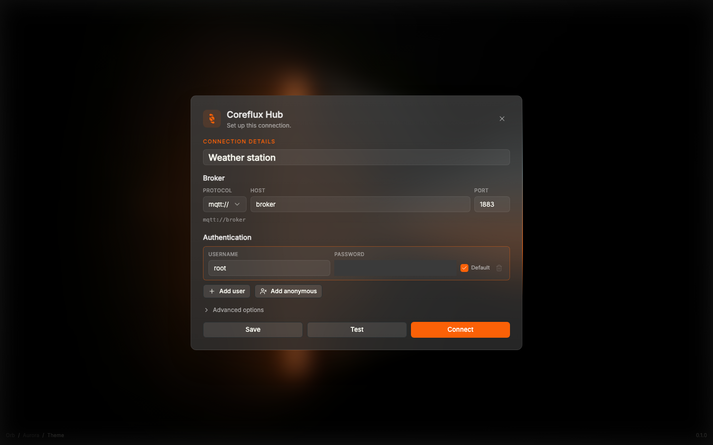
   *The form is already filled in: click **Connect**.*

3. A short walkthrough tour pops up — click **Skip** (or step through it if you like).

   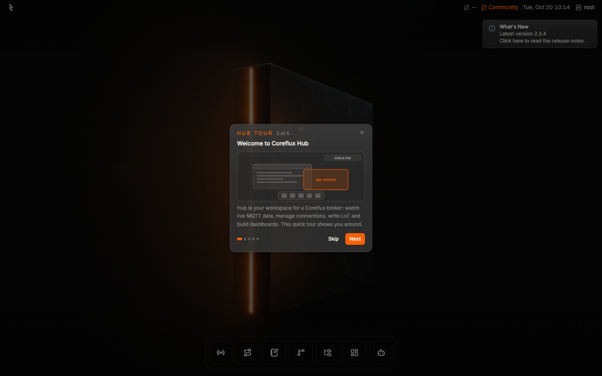
   *The tour: click **Skip**.*

### 2.2 Find your way around the HUB

Spot two areas on the screen:

- **The Dock (bottom center):** Icons that open the main tools — **Data Viewer**, **Connectors**, **LoT Editor**, and **Dashboards** (hover over any icon to see its name).

  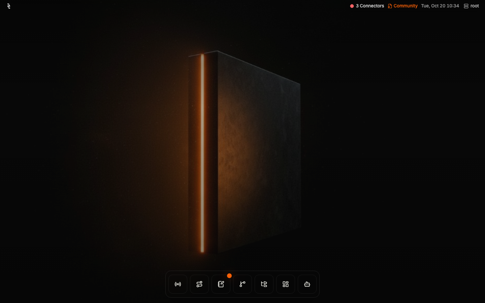
  *The HUB desktop: the dock at the bottom opens your tools.*

- **The Top-Right Bar:**
  - Your username (**`root`**) opens a menu with **Command Console**, **Broker Settings**, and **Log out**.

    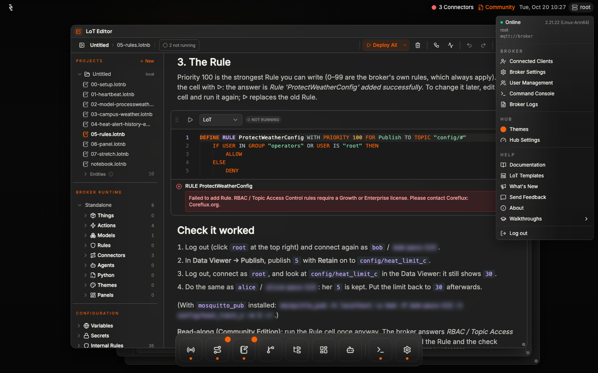
    *Click `root` at the top right for **Command Console**, **Broker Settings** and **Log out**.*

  - Next to `root` is a badge showing your broker's current licence (**`Community`** on a fresh broker).

    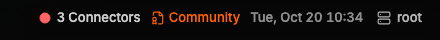
    *The licence badge (*Community*, or your activated licence tier) next to `root`.*

### 2.3 Open the lesson in the LoT Editor

The lesson is stored on the broker as the project **`weather-station`**. Bring its files into the editor once:

1. Click **LoT Editor** in the bottom dock.
2. Under **Projects**, right-click **`weather-station`** and click **Pull project from broker**.

   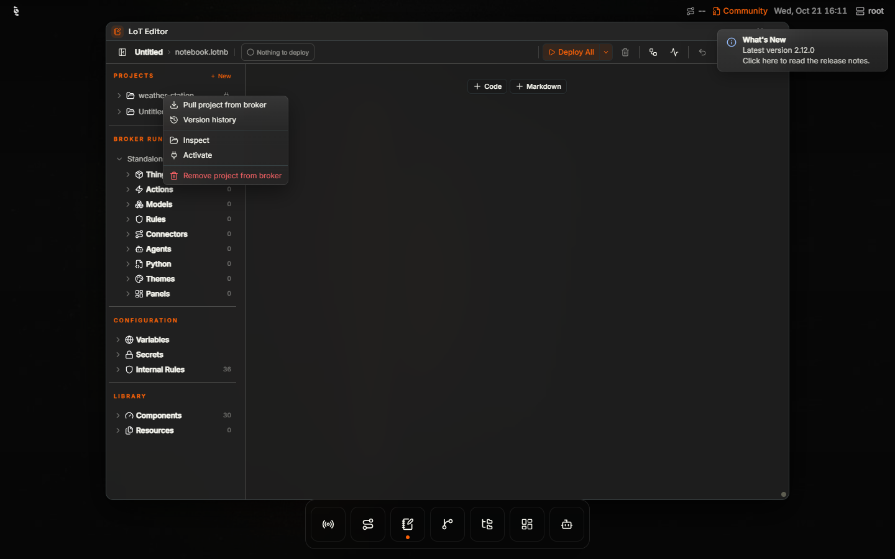
   *Right-click `weather-station` under **Projects** → **Pull project from broker**.*

3. The project's files appear in the tree: `project/` with the lab notebooks, `index.html` and the guides. `00-setup` opens. The header shows `10 not running`: nothing is deployed until you run the cells in the labs.

   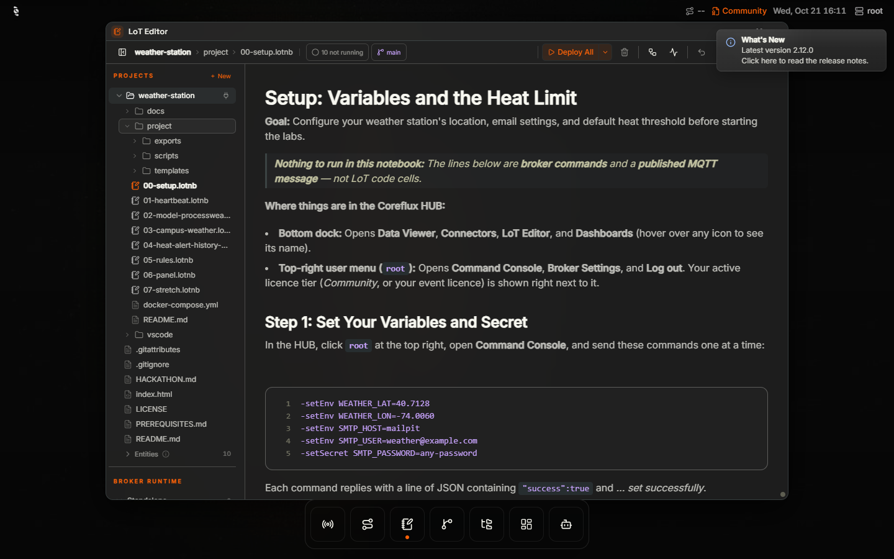
   *The files are in the tree and `00-setup` opens. `10 not running` means nothing is deployed yet.*

Do **not** click **Activate** on the project: that deploys every lab at once.

*Want to see how all the pieces fit together before you write code? See [Learn about Coreflux concepts](#learn-about-coreflux-concepts-indexhtml).*

---

## 5. Step 3: Configure variables and the heat limit (`00-setup`)

Your weather station needs coordinates to query and an initial heat threshold in °C. Rather than hardcoding coordinates or passwords inside LoT code, we store them in the broker's **Variables & Secrets** and on a **retained configuration topic**.

These steps are also in `project/00-setup.lotnb` in the LoT Editor:

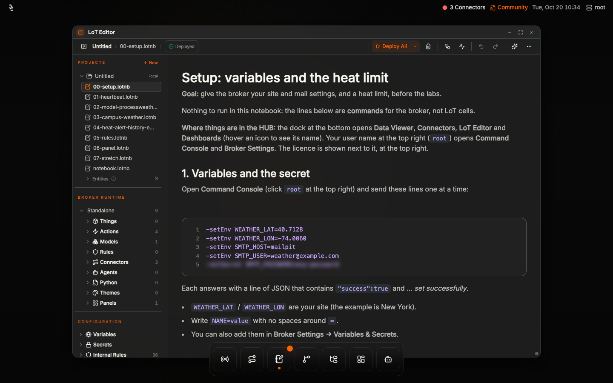
*The `00-setup` notebook in the LoT Editor.*

### 3.1 Set the environment variables and secret

You need four variables and one secret:

| Name | Value | Kind |
|---|---|---|
| `WEATHER_LAT` | `40.7128` | Variable |
| `WEATHER_LON` | `-74.0060` | Variable |
| `SMTP_HOST` | `mailpit` | Variable |
| `SMTP_USER` | `weather@example.com` | Variable |
| `SMTP_PASSWORD` | `any-password` | Secret |

`WEATHER_LAT` and `WEATHER_LON` are the latitude and longitude for your station (the example is New York — feel free to use your own city's coordinates!). Set them in **one** of two ways.

#### Option A: Command Console

1. Click **`root`** at the top right of the HUB and select **Command Console**.
2. Paste and send the following commands **one at a time**:

   ```text
   -setEnv WEATHER_LAT=40.7128
   -setEnv WEATHER_LON=-74.0060
   -setEnv SMTP_HOST=mailpit
   -setEnv SMTP_USER=weather@example.com
   -setSecret SMTP_PASSWORD=any-password
   ```

   - Each command replies with JSON containing `"success":true` and `… set successfully`.
   - Make sure there are **no spaces around `=`** (`NAME=value`).

   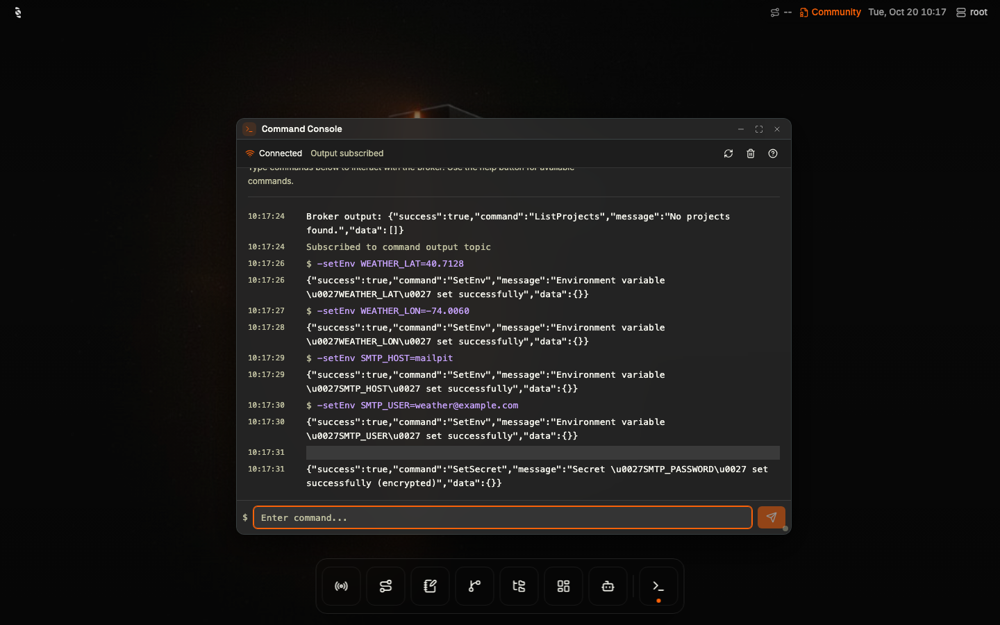
   *Sending the `-setEnv` commands in Command Console: each replies with `"success":true`.*

#### Option B: the Variables & Secrets screens

No commands to type: fill in a form instead.

1. Click **`root`** at the top right → **Broker Settings** → **Variables & Secrets**. The **Variables** list is empty, with an add row at the bottom.
2. In the add row, type the name (`WEATHER_LAT`) in the first box and the value (`40.7128`) in the second, then press **Enter** (or click the ✓).

   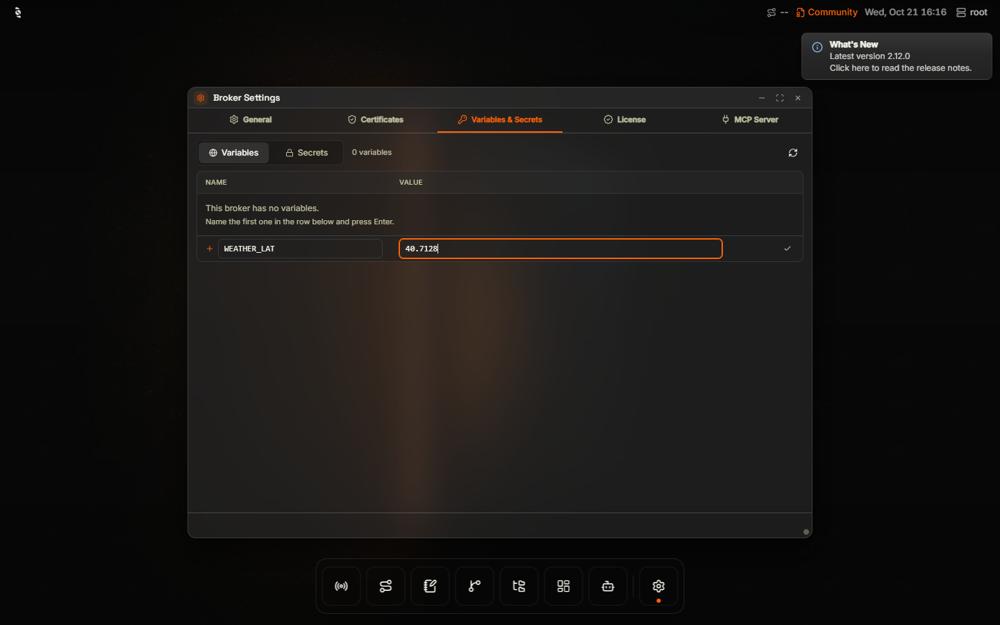
   *The add row: name on the left, value on the right, then **Enter**.*

3. Repeat for `WEATHER_LON`, `SMTP_HOST` and `SMTP_USER`. Each one is saved to the broker and listed.

   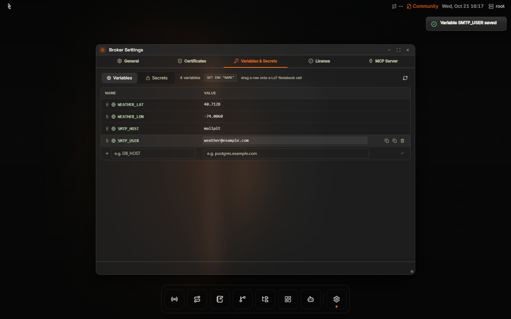
   *All four variables saved.*

4. Click **Secrets**. Type `SMTP_PASSWORD` as the name and `any-password` as the value (the value stays hidden), then press **Enter**.

   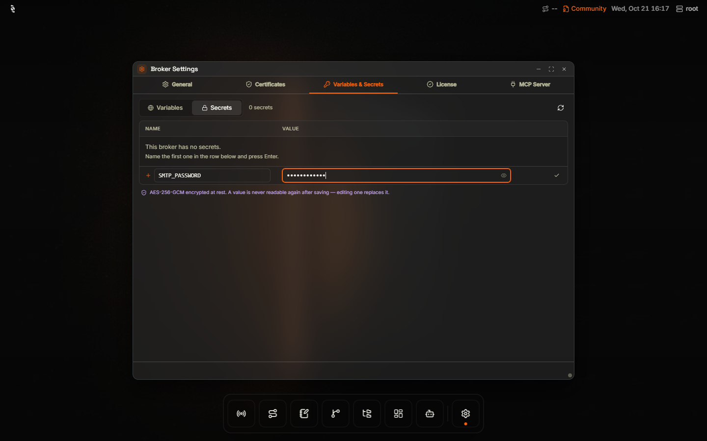
   *The Secrets add row: the value is hidden as you type.*

   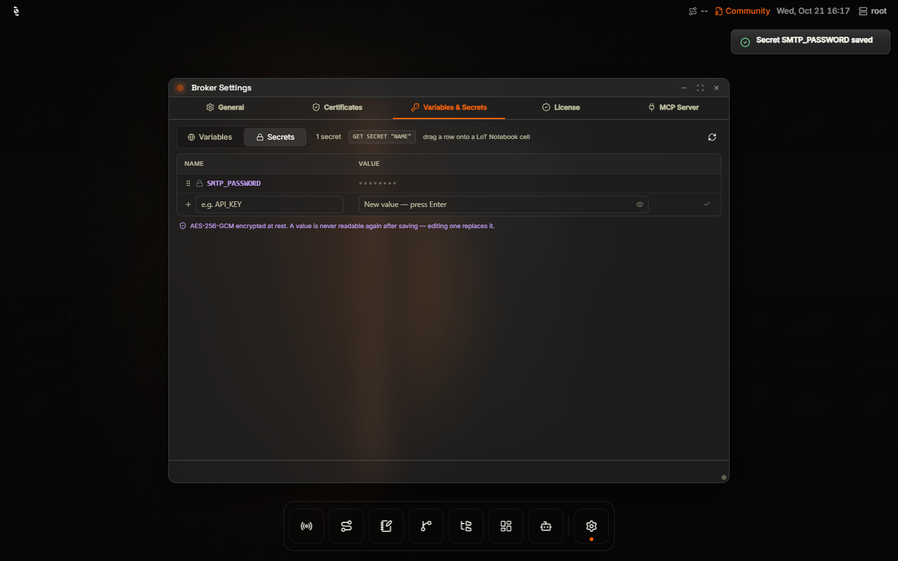
   *The secret is saved. Its value is never shown again.*

#### Check it worked

Whichever option you used: **`root` → Broker Settings → Variables & Secrets** shows the 4 variables under **Variables** and `SMTP_PASSWORD` under **Secrets** (secret values are hidden).

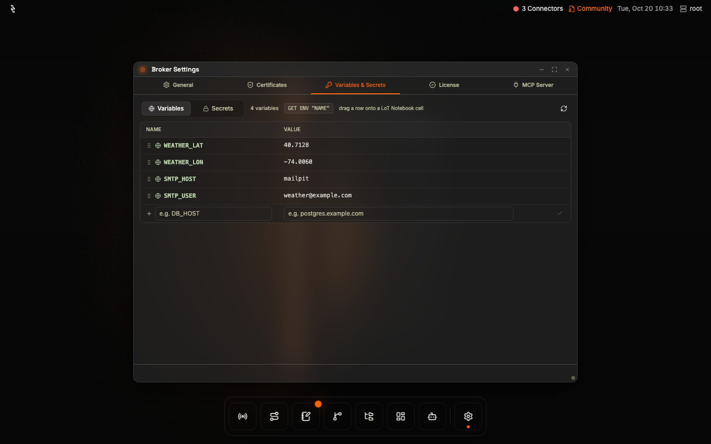
*Variables: all four are listed.*

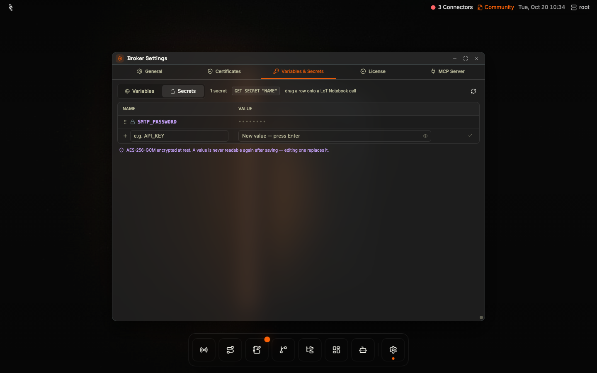
*Secrets: `SMTP_PASSWORD` is listed, its value never displayed.*

### 3.2 Publish the initial heat limit (`30` °C)

1. Open **Data Viewer** from the bottom dock.
2. Click the **Publish** button (the paper-plane icon on the left side of Data Viewer).
3. Fill in:
   - **Topic:** `config/heat_limit_c`
   - **Payload:** `30`
   - **Retain:** Switch **ON** (this makes the broker keep `30` stored on the topic so Actions can read it at any time).
4. Click **Publish**.

   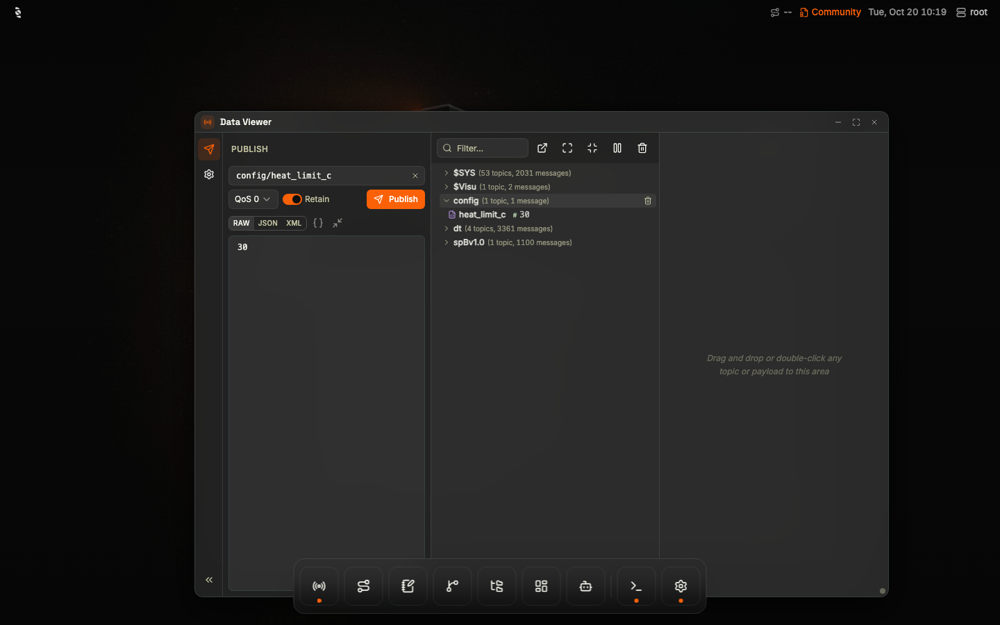
   *Data Viewer → Publish: send `30` to `config/heat_limit_c` with **Retain** turned on.*

5. **Verify:** In the Data Viewer topic tree, expand `config` → `heat_limit_c` and confirm its value is `30`.

---

## 6. Step 4: Build the station (Labs 1–6)

Open **LoT Editor** from the bottom dock. Under `weather-station` → `project/`, you will see the lab notebooks (`01-heartbeat` through `07-stretch`). If the tree only shows **Entities**, pull the project first ([Step 2.3](#23-open-the-lesson-in-the-lot-editor)).

### How to work with notebooks in the LoT Editor

- **One notebook per lab:** Open them in order (`01` through `06`). Later labs build on topics and pieces created in earlier labs.
- **How to deploy code:**
  - Click **▷** (Run Cell) at the top-left of a code cell to deploy that single piece to the broker, **or**
  - Click **Deploy All** at the top-right of the notebook to deploy all cells in that notebook from top to bottom.
  - Each cell shows a green confirmation (*`… added successfully`*) when deployed.
- **If you edit a cell:** Just click **▷** again — the broker updates the Action, Model, Connector, Rule, or Panel in place.
- **Important:** Do **not** use *Push project to broker* or *Activate* in the project menu; run cells with **▷** or **Deploy All** as you progress through each lab.

| Lab | Notebook | What you deploy |
|---|---|---|
| **Lab 1** | `01-heartbeat` | `Heartbeat` Action (timer trigger every 5s) |
| **Lab 2** | `02-model-processweather` | `WeatherReading` Model + `ProcessWeather` Action (JSON parsing & unit math) |
| **Lab 3** | `03-campus-weather` | `CampusWeather` REST Connector + `RequestWeather` Action |
| **Lab 4** | `04-heat-alert-history-email` | `HeatAlert` Action + `WeatherHistory` CSV Connector + `HeatMail` Email Connector |
| **Lab 5** | `05-rules` | `ProtectWeatherConfig` Rule (requires event licence; read-along on Community) |
| **Lab 6** | `06-panel` | `CampusWeather` live Dashboard Panel |

---

### Lab 1: Heartbeat

**Notebook:** `project/01-heartbeat`  
**Goal:** Deploy your first LoT Action and see live messages arriving in the Data Viewer.

#### What you are building
A simple `Heartbeat` Action that runs on a 5-second timer (`ON EVERY 5 SECONDS DO`) and publishes `"ok"` to the topic `campus/weather/heartbeat`.

#### Steps
1. In **LoT Editor**, click **`project/01-heartbeat`** in the left sidebar.

   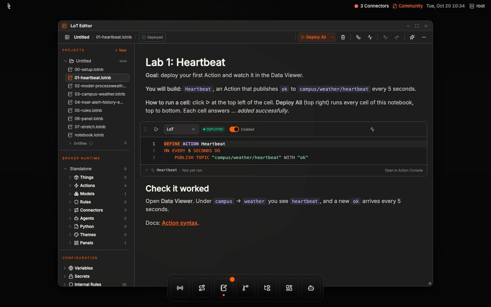
   *`01-heartbeat` open in the LoT Editor.*

2. Click **▷** at the top left of the code cell (or **Deploy All** at the top right). Confirm it says *`Action 'Heartbeat' added successfully`*.

   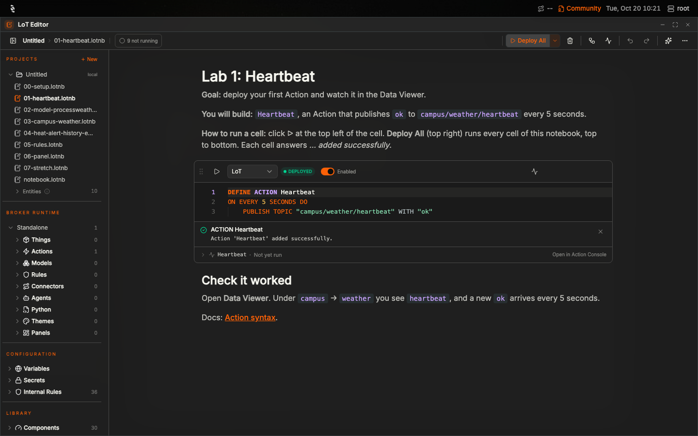
   *The cell after ▷: the Action is deployed.*

3. Open **Data Viewer** from the bottom dock.
4. Expand `campus` → `weather` → `heartbeat` and watch a new `ok` message arrive every 5 seconds.

   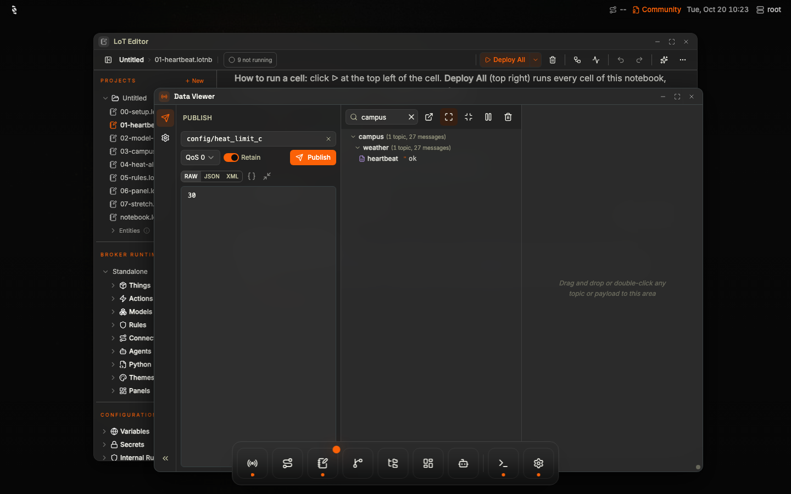
   *In Data Viewer, `campus/weather/heartbeat` receives `ok` every 5 seconds.*

---

### Lab 2: Model and unit conversion

**Notebook:** `project/02-model-processweather`  
**Goal:** Define a clean data structure (`WeatherReading`) and write an Action (`ProcessWeather`) that converts raw weather JSON into °C, °F, km/h, and mph.

#### What you are building
1. **`WeatherReading` (Model):** Defines the 5 fields every clean weather reading will have (`temperature_c`, `temperature_f`, `wind_kmh`, `wind_mph`, and `timestamp`). The keyword `COLLAPSED` means the Model only publishes when an Action explicitly fills and sends it with `PUBLISH MODEL`.
2. **`ProcessWeather` (Action):** Listens to `campus/weather/raw`. When a JSON payload arrives:
   - If `current.temperature_2m` is missing (`EMPTY` or `"null"`), it forwards the error payload to `campus/weather/errors`.
   - Otherwise, it extracts Celsius and km/h, calculates Fahrenheit and mph, and publishes a complete `WeatherReading` JSON object to `campus/weather/reading`.

#### Steps
1. In **LoT Editor**, open **`project/02-model-processweather`**.
2. Run Cell 1 (`DEFINE MODEL WeatherReading`) with **▷**, then Cell 2 (`DEFINE ACTION ProcessWeather`) with **▷** — or click **Deploy All** to run both in order.

   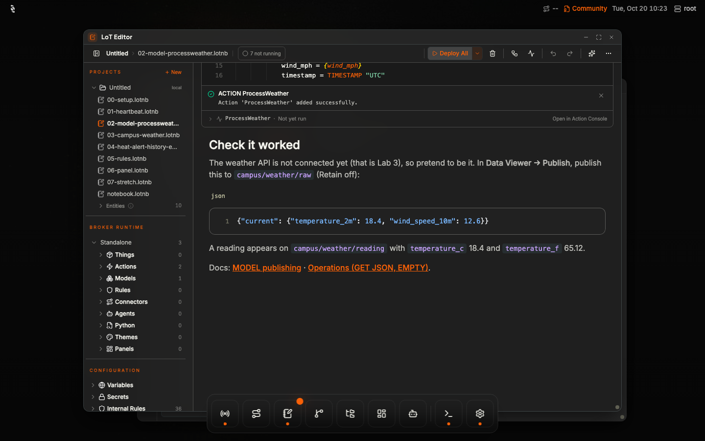
   *Both cells of `02-model-processweather` deployed.*

3. **Test it with simulated data** (we will connect the real weather API in Lab 3):
   - Open **Data Viewer → Publish**.
   - **Topic:** `campus/weather/raw`
   - **Retain:** **OFF**
   - **Payload:**
     ```json
     {"current": {"temperature_2m": 18.4, "wind_speed_10m": 12.6}}
     ```
   - Click **Publish**.

   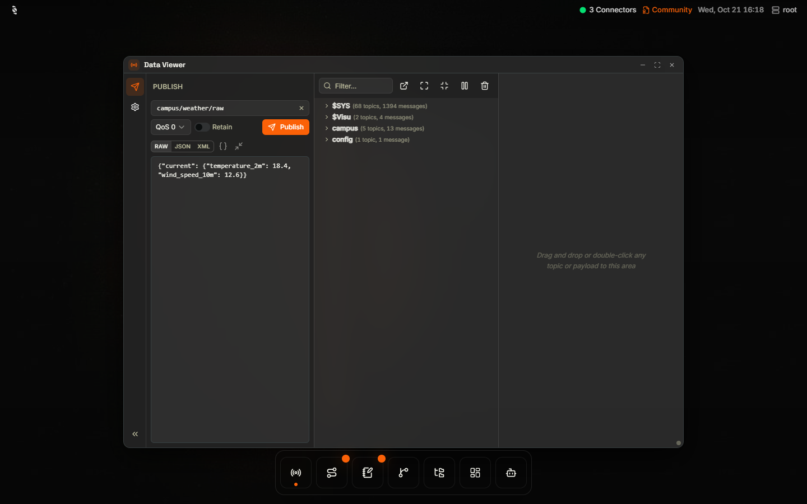
   *Data Viewer → Publish: the sample answer to `campus/weather/raw`, **Retain** off.*

4. **Verify:** In **Data Viewer**, click `campus/weather/reading`. You should see a clean JSON payload with `"temperature_c": 18.4`, `"temperature_f": 65.12`, `"wind_kmh": 12.6`, `"wind_mph": 7.829...`, and a UTC `"timestamp"`.

   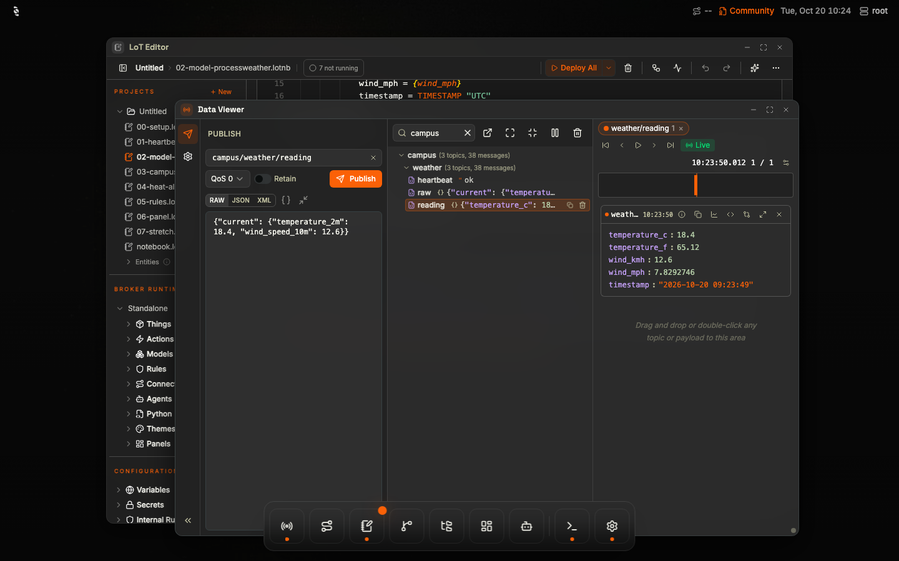
   *The converted reading on `campus/weather/reading`.*

---

### Lab 3: Fetch real weather

**Notebook:** `project/03-campus-weather`  
**Goal:** Connect your broker to the live [Open-Meteo](https://open-meteo.com) REST API and schedule automatic polling every 5 minutes.

#### What you are building
1. **`CampusWeather` (Connector):** A `REST_API` Connector that watches `campus/weather/request`. Whenever a message arrives there, it makes an HTTPS `GET` request to Open-Meteo using your `{env.WEATHER_LAT}` and `{env.WEATHER_LON}` variables, and publishes the API response to `campus/weather/raw` (where `ProcessWeather` from Lab 2 automatically picks it up!).
2. **`RequestWeather` (Action):** A timer Action that publishes `"poll"` to `campus/weather/request` every 5 minutes.

#### Steps
1. In **LoT Editor**, open **`project/03-campus-weather`**.
2. Click **Deploy All** (or run each cell with **▷**).

   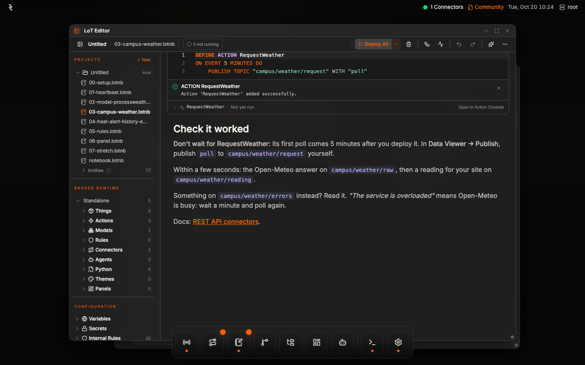
   *`03-campus-weather` deployed.*

3. **Trigger an immediate poll** (the 5-minute timer waits 5 minutes before its first automatic tick):
   - Open **Data Viewer → Publish**.
   - **Topic:** `campus/weather/request`
   - **Payload:** `poll`
   - **Retain:** **OFF**
   - Click **Publish**.

   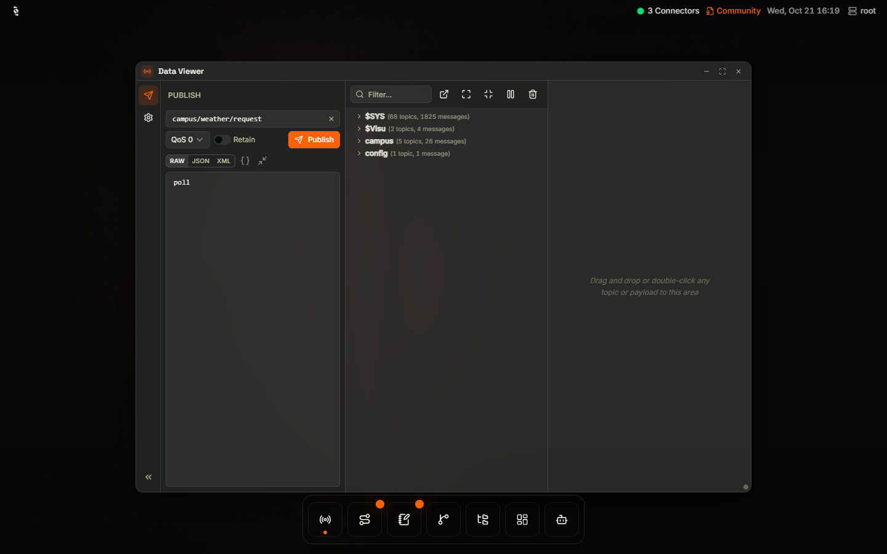
   *Data Viewer → Publish: `poll` to `campus/weather/request`, **Retain** off.*

4. **Verify:** Within a couple of seconds, check **Data Viewer**:
   - `campus/weather/raw` shows the live JSON response from Open-Meteo.
   - `campus/weather/reading` updates with the real temperature and wind speed for your coordinates!
   *(If nothing appears on `reading`, check `campus/weather/errors` — if Open-Meteo returned a 503 overload error, wait a minute and publish `poll` again.)*

   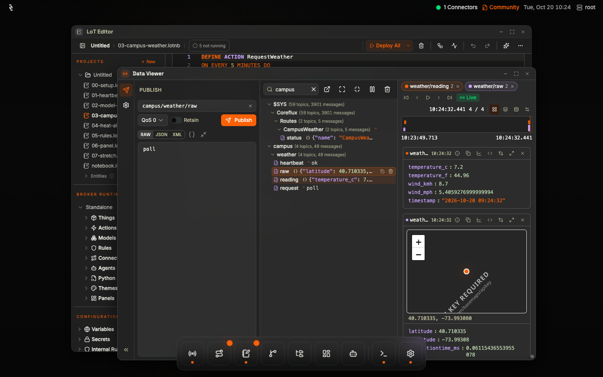
   *Real weather arrives on `raw` and is converted on `reading`.*

---

### Lab 4: Heat alert, CSV history, and email

**Notebook:** `project/04-heat-alert-history-email`  
**Goal:** React to every weather reading: raise an alert when it gets too hot, log every reading to a CSV file, and send one email notification per heat wave.

#### What you are building
1. **`HeatAlert` (Action):** Runs on every message to `campus/weather/reading`. It compares `temperature_c` against the retained value on `config/heat_limit_c`:
   - Publishes `"on"` or `"off"` to `campus/weather/alerts/heat_active` on every reading.
   - Only when the state **transitions** from `"off"` to `"on"`, it publishes the reading to `campus/weather/alerts/heat` — ensuring your team gets **one email per heat episode**, not an email every 5 minutes!
2. **`WeatherHistory` (Connector):** A `FILE_STORAGE` Connector that appends every reading on `campus/weather/reading` as a new row in `project/exports/campus-weather.csv`.
3. **`HeatMail` (Connector):** An `EMAIL` Connector that watches `campus/weather/alerts/heat`, fills in the HTML template (`project/templates/heat-alert.html`), and sends the email to Mailpit (`http://localhost:8025`).

#### Steps
1. In **LoT Editor**, open **`project/04-heat-alert-history-email`** and click **Deploy All** (or run all 3 cells with **▷**).

   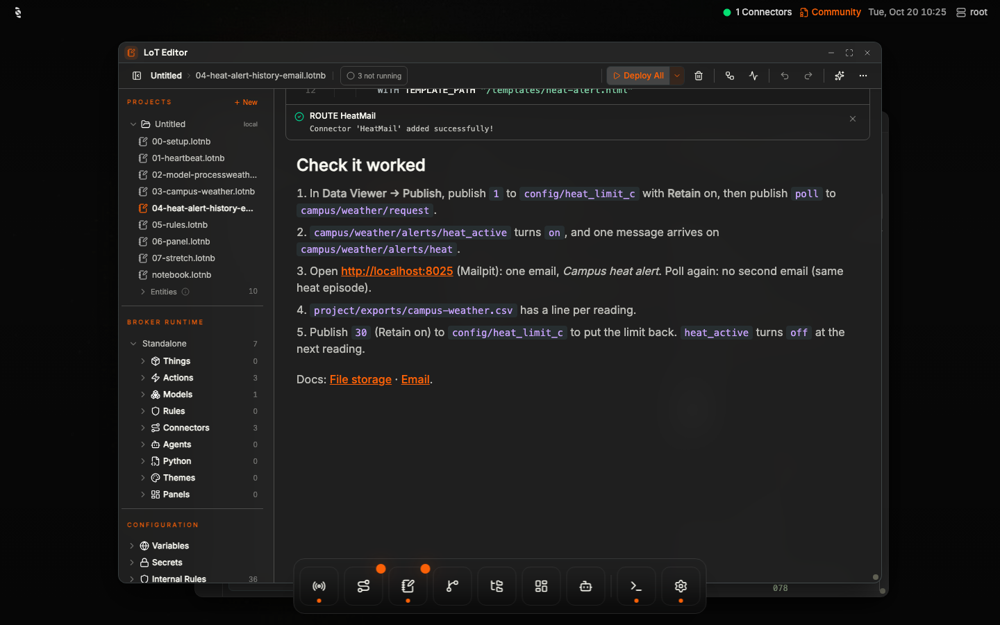
   *`04-heat-alert-history-email` deployed.*

2. **Simulate a heat wave** by lowering the threshold below the current temperature:
   - In **Data Viewer → Publish**, publish `1` to `config/heat_limit_c` with **Retain** turned **ON**.

     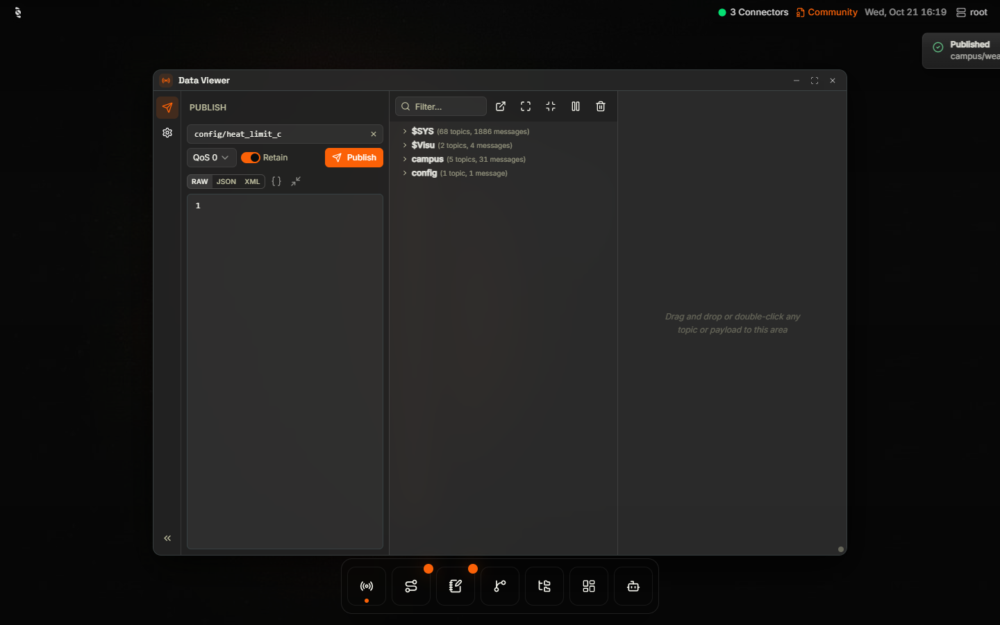
     *Data Viewer → Publish: `1` to `config/heat_limit_c`, **Retain** on.*

   - Next, publish `poll` to `campus/weather/request` (with **Retain** **OFF**), as in [Lab 3](#lab-3-fetch-real-weather).
3. **Verify all three outputs:**
   - **Alert topics (Data Viewer):** `campus/weather/alerts/heat_active` is now `on`, and `campus/weather/alerts/heat` received the reading.

     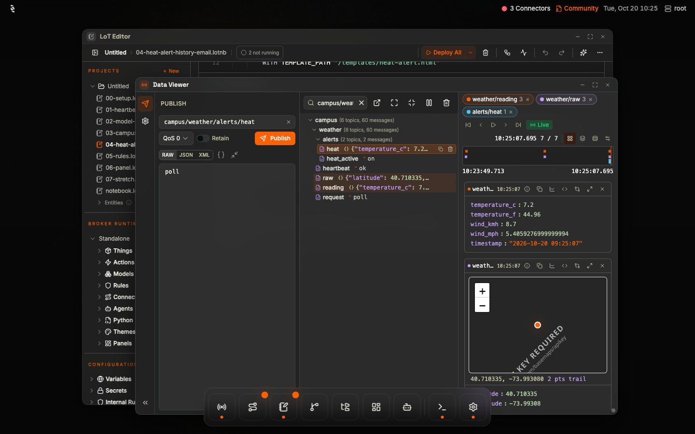
     *`heat_active` is `on` and one message is on `alerts/heat`.*

   - **Email (Mailpit):** Open **http://localhost:8025** in a browser tab. You will see one email titled **Campus heat alert** with the °C and °F values filled in! *(Try publishing `poll` to `campus/weather/request` a second time — notice that **no second email** is sent because you are still in the same heat episode.)*

     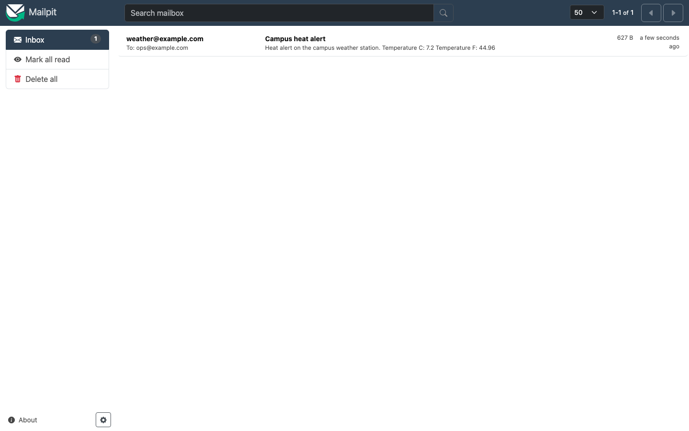
     *Mailpit at http://localhost:8025: one alert email.*

     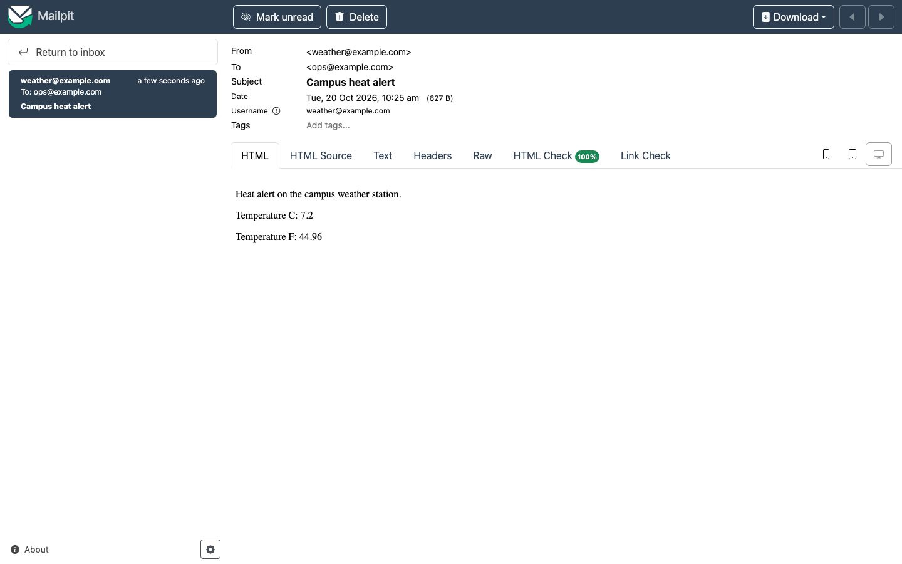
     *The HTML email with the temperature in °C and °F.*

   - **CSV file:** Check `project/exports/campus-weather.csv` on your computer (or in the LoT Editor file tree) — a new line is added on every reading.

     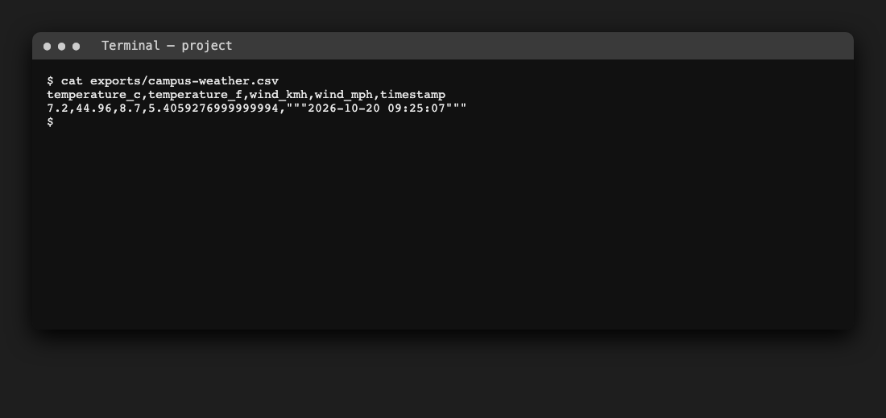
     *`project/exports/campus-weather.csv`: one row per reading.*

     *(Note: In the HUB's **Connectors** window, `WeatherHistory` shows a red/disconnected dot. That is normal for file connectors because they only open the file briefly when writing a line.)*

     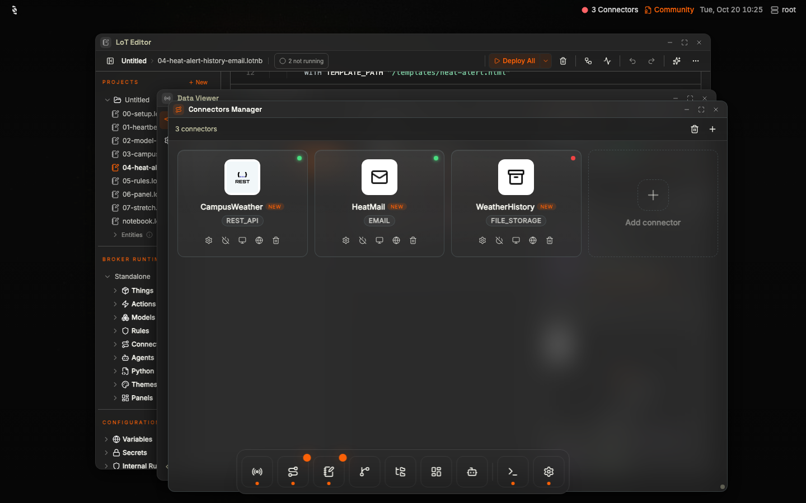
     *`WeatherHistory` shows red in the Connectors window: normal for file Connectors.*

4. **Reset the heat limit:**
   - In **Data Viewer → Publish**, publish `30` to `config/heat_limit_c` with **Retain** turned **ON**, then publish `poll` to `campus/weather/request`.
   - Confirm `campus/weather/alerts/heat_active` returns to `off`.

---

### Lab 5: Protect the heat limit with a Rule

**Notebook:** `project/05-rules`  
**Goal:** Lock down `config/#` so only users in the `operators` group (and `root`) can change the heat threshold.

> **Licence note:** Custom access-control Rules (`DEFINE RULE`) require a licensed broker (Trial / Growth / Enterprise).
> - **At a live hackathon event:** Use the activation code (`CFLX-…`) provided by the organisers in Step 5.1 below.
> - **Running on your own without a code (Community Edition):** You can still try deploying the Rule to see the licence check in action and read through how `ProtectWeatherConfig` works, then continue to Lab 6!

#### Steps
1. **Activate your event licence (if you have a code):**
   - Click **`root` → Broker Settings → License → Activation code**, paste your `CFLX-…` code, and click **Activate** (or send `-activateLicense CFLX-your-code` in **Command Console**).

     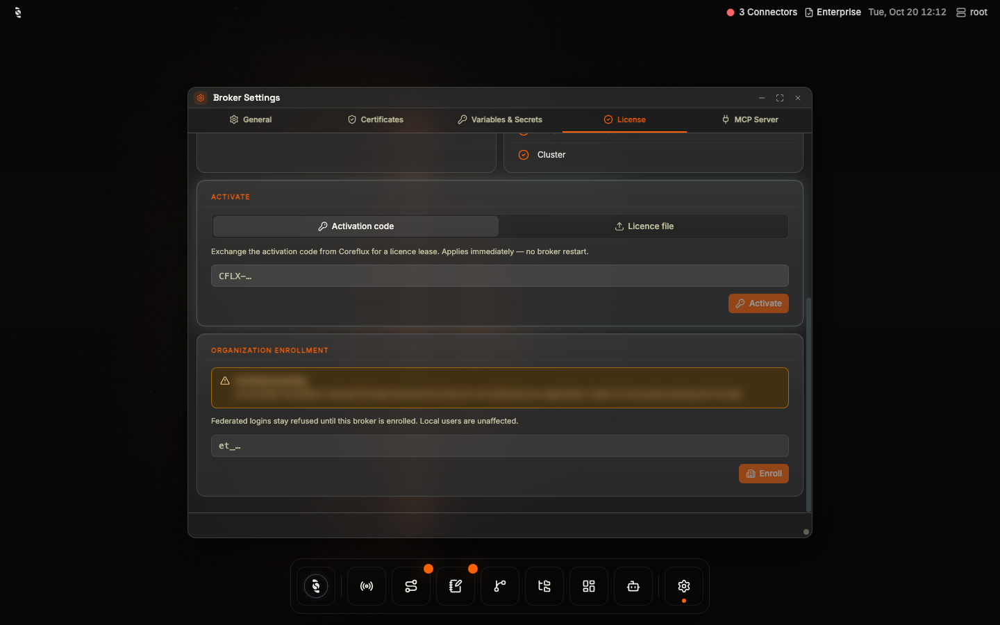
     *Broker Settings → License: paste the `CFLX-…` code and click **Activate**.*

     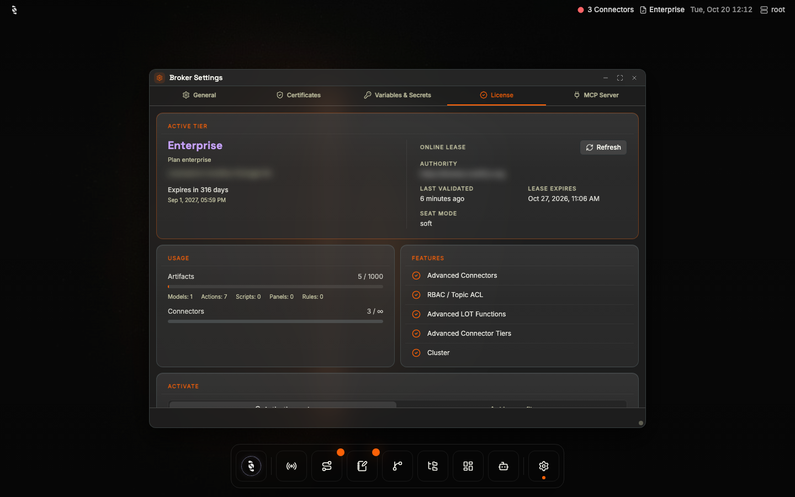
     *Once active, **RBAC / Topic ACL** is ticked under Features.*

   - The badge next to `root` at the top right changes from *Community* to your licence tier. *(Activate only once — each `docker compose down -v` wipes the broker volume and consumes another seat if re-activated.)*

     
     *The badge shows your active licence.*

2. **Create two test users (`alice` and `bob`) and the `operators` group:**
   - Open **Command Console** (`root` → **Command Console**) and send these three commands one by one:
     ```text
     -addUser alice alice-pass-123
     -addUserToGroup alice operators
     -addUser bob bob-pass-123
     ```
   - `alice` is in the `operators` group; `bob` is not.

     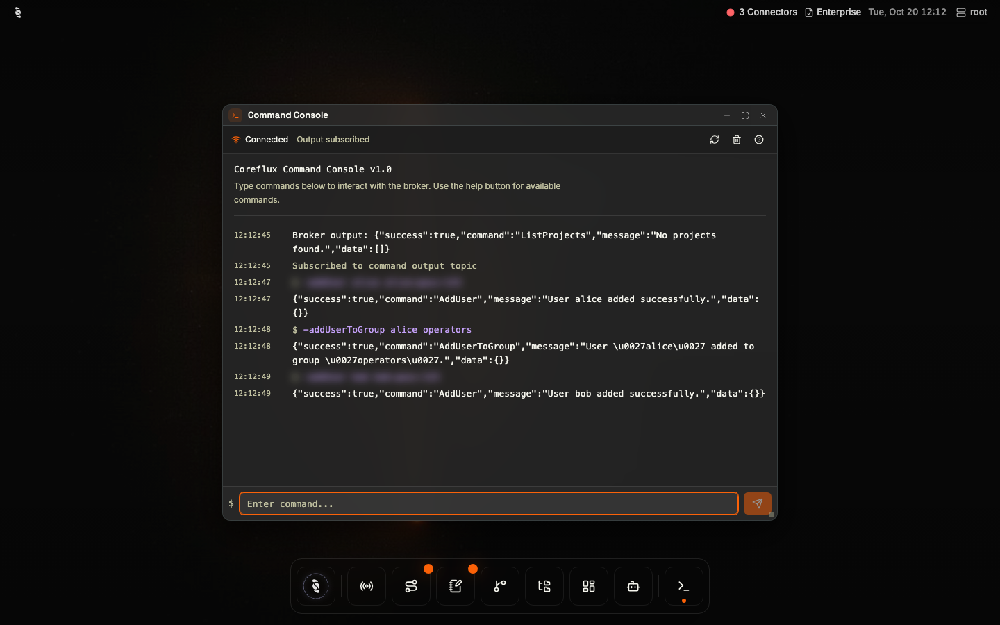
     *Command Console: `alice` (in `operators`) and `bob` created.*

3. **Deploy the Rule:**
   - In **LoT Editor**, open **`project/05-rules`** and click **▷** on the `ProtectWeatherConfig` cell.
   - It deploys a Rule at priority `100` that allows `Publish` to `config/#` **only** if `USER IN GROUP "operators" OR USER IS "root"`, and denies everyone else.

     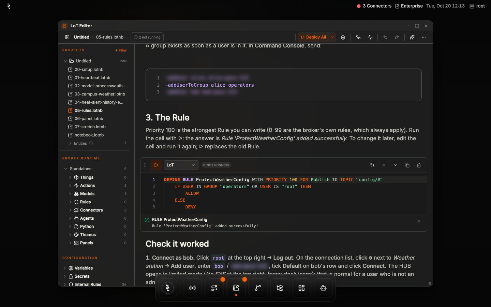
     *With a licence: *Rule 'ProtectWeatherConfig' added successfully!**

     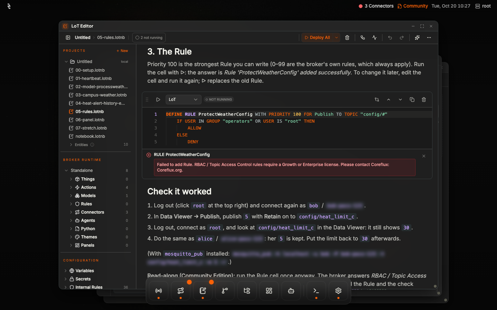
     *On Community Edition the broker refuses the Rule. Read along and continue to Lab 6.*

4. **Test as `bob` (unauthorized user):**
   - Click **`root` → Log out** at the top right.
   - On the Connections screen, click the **⚙ (gear icon)** on the *Weather station* card → **Add user**.
   - Enter username `bob`, password `bob-pass-123`, tick **Default** on `bob`'s row, and click **Connect**.

     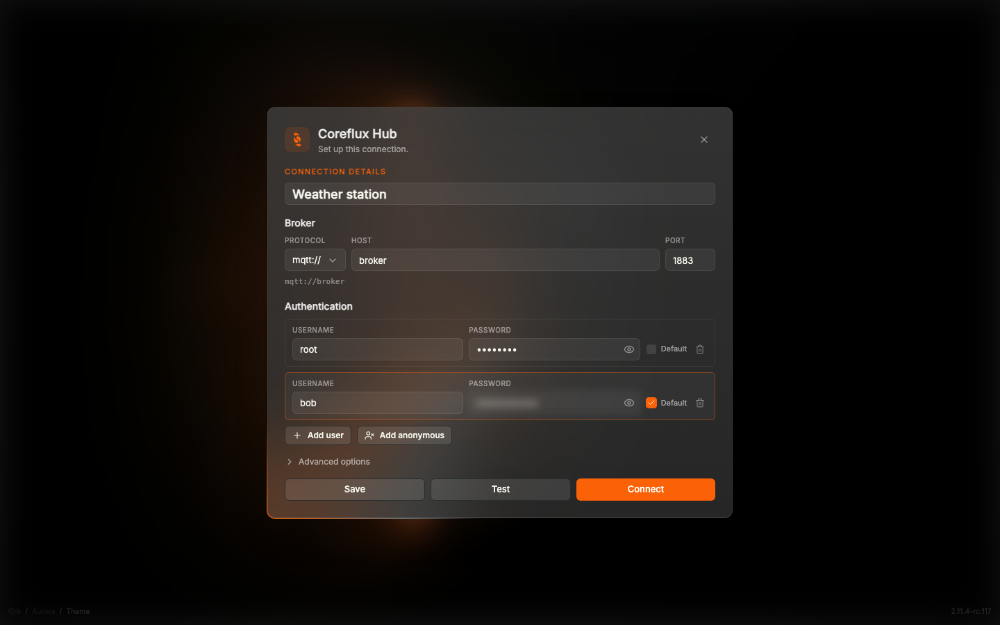
     *⚙ on *Weather station* → **Add user**, add `bob`, tick **Default**, **Connect**.*

   - *(Notice the HUB shows `No SYS` at the top right and fewer dock icons — that is normal because `bob` is not an admin.)*

     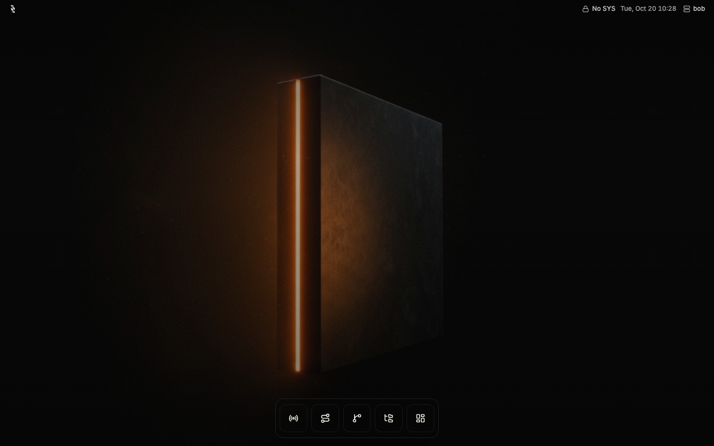
     *As `bob`: *No SYS* and fewer dock icons.*

   - Open **Data Viewer → Publish** and try to publish `5` (with **Retain** **ON**) to `config/heat_limit_c`.
   - The HUB says *Sent (delivery unconfirmed)* — MQTT silently drops unauthorized publishes without returning an error to the sender.

     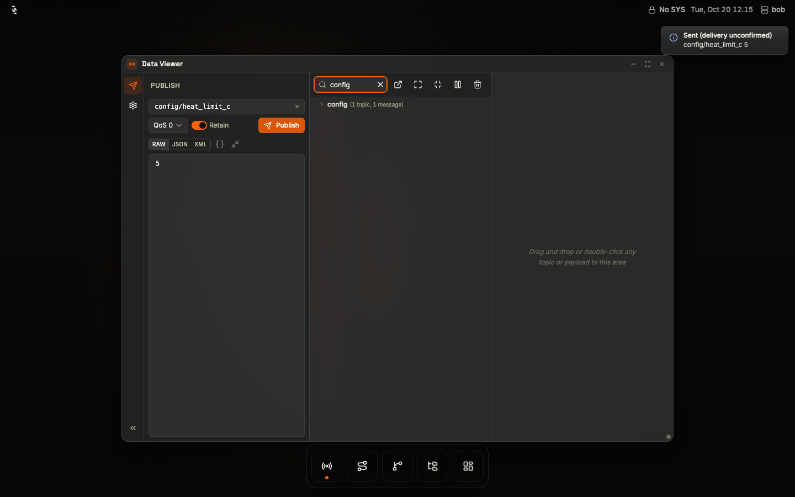
     *`bob` publishes `5` to `config/heat_limit_c`: the broker silently drops it.*

5. **Switch back to `root` and verify `bob` was blocked:**
   - Click **`bob` → Log out** at the top right.
   - On the *Weather station* card, click the user chip (`bob`) next to **Connect**, select **`root`**, and click **Connect**.

     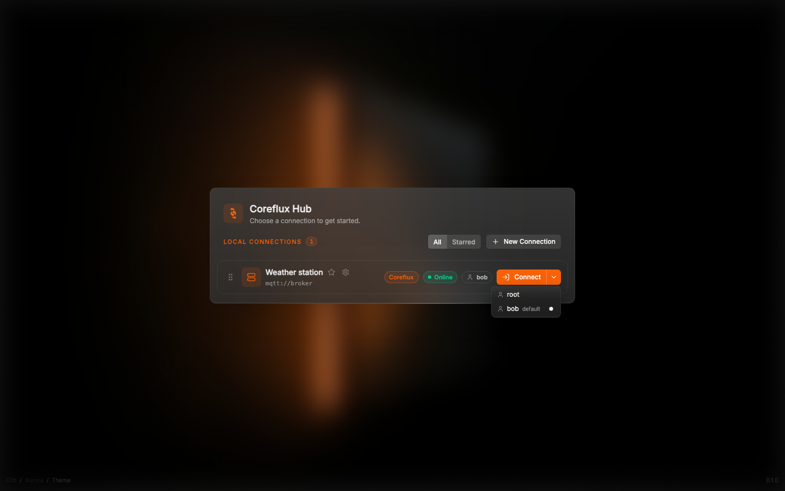
     *Switch the user chip back to `root` and click **Connect**.*

   - Open **Data Viewer** and check `config/heat_limit_c` — it still shows **`30`**! `bob`'s change was rejected.

     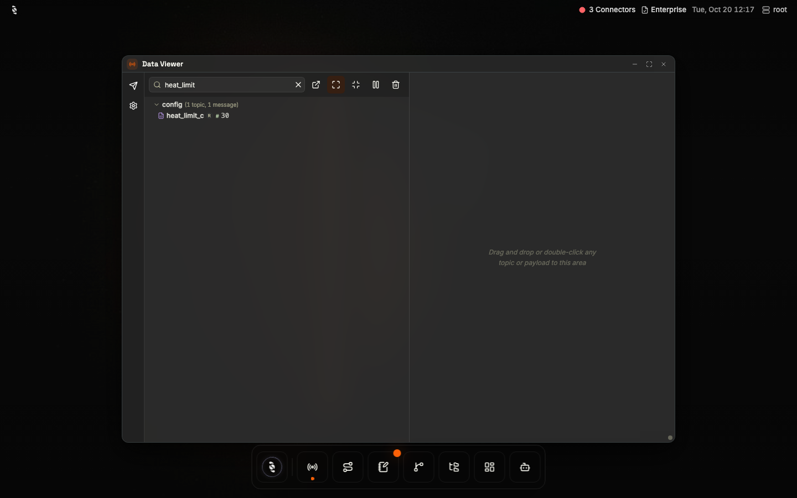
     *Back as `root`: `config/heat_limit_c` is still `30`.*

   - *(Optional)* Repeat the test logging in as `alice` (`alice-pass-123`) — because she is in `operators`, her publish succeeds! Remember to set `config/heat_limit_c` back to `30` as `root` before moving on.

---

### Lab 6: Build the live dashboard

**Notebook:** `project/06-panel`  
**Goal:** Deploy a live operator dashboard (`CampusWeather`) in the HUB using LoT.

#### What you are building
A 4-column `DEFINE PANEL` with:
1. **`TempGauge`** — A gauge showing Celsius (`temperature_c` from `campus/weather/reading`).
2. **`TempF`** — A value card showing Fahrenheit (`temperature_f` from `campus/weather/reading`).
3. **`Wind`** — A value card showing wind speed in km/h (`wind_kmh` from `campus/weather/reading`).
4. **`HeatState`** — A text card showing whether the heat alert is `on` or `off` (`campus/weather/alerts/heat_active`).

#### Steps
1. In **LoT Editor**, open **`project/06-panel`** and click **▷** on the cell (or **Deploy All**).

   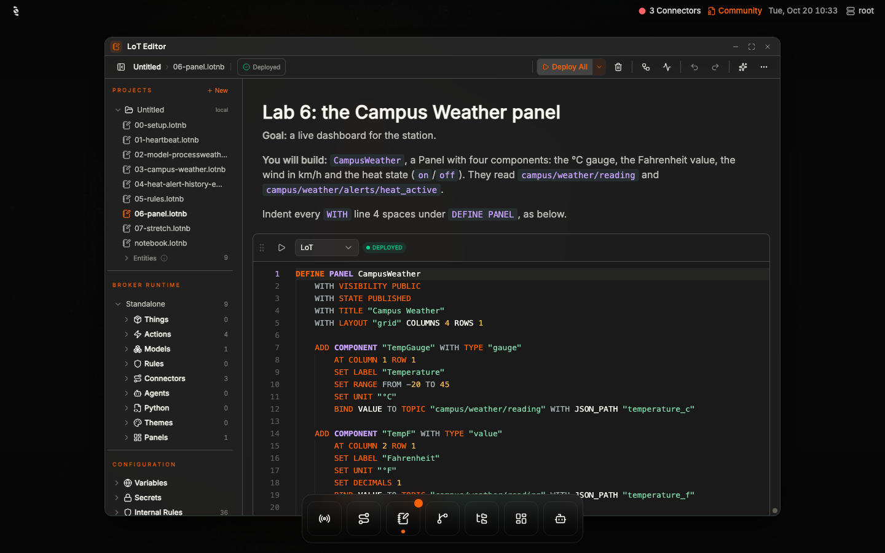
   *`06-panel` deployed.*

2. Open **Dashboards** from the bottom dock.
3. Click **Campus Weather** in the dashboard list.

   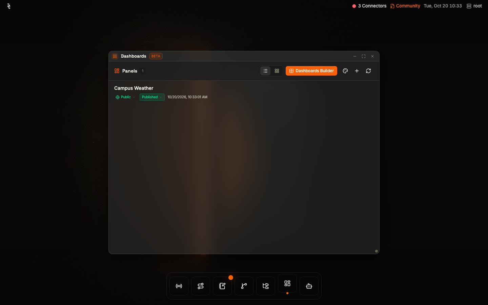
   *Dashboards lists *Campus Weather*.*

4. If any card shows `---` (waiting for the next non-retained reading), open **Data Viewer → Publish** and send `poll` to `campus/weather/request`.
5. Watch all four cards populate live!

   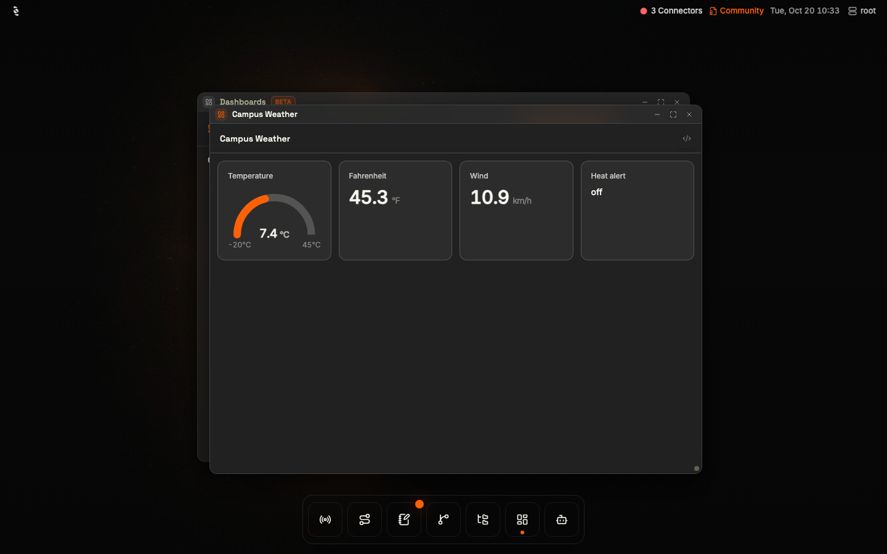
   *°C, °F, wind and the heat state, live.*

---

## 7. Stretch goals (`07-stretch`)

Finished the 6 core labs? Open **`project/07-stretch`** in the **LoT Editor**! It contains hints for 6 extra challenges — create new LoT code cells right inside `07-stretch` (one `DEFINE` per cell) and deploy them with **▷**:

1. **Protect the alert and raw topics with a Rule (event licence):** Stop regular users like `bob` from publishing fake data to `campus/weather/raw` or fake alerts to `campus/weather/alerts/heat`, while still letting the broker's own Connector and Action publish there.
2. **Wind alert:** Add a `config/wind_limit_kmh` threshold and a `WindAlert` Action that publishes `on`/`off` to `campus/weather/alerts/wind_active`.
3. **Daily min and max:** Track the day's lowest and highest temperatures using `KEEP TOPIC` and publish a daily summary at `23:59:00`.
4. **A second site:** Add a second event to the `CampusWeather` Connector to poll a second city's coordinates.
5. **Expand the dashboard:** Widen the `CampusWeather` Panel in `06-panel` to 6 columns (`COLUMNS 6`) and add cards for `wind_mph` and `timestamp`.
6. **Package the station as a reusable `DEFINE THING TEMPLATE`:** Turn the whole weather station into a template (shown on Slide 11 of `index.html`) so spinning up a new site takes just 3 lines of LoT!

   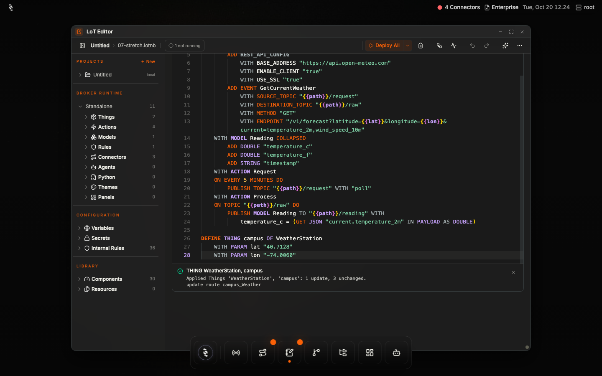
   *A cell in `07-stretch` with `DEFINE THING TEMPLATE WeatherStation` and `DEFINE THING campus OF WeatherStation`, run with ▷. (It creates a 4th Connector: on Community Edition, remove one first with `-removeConnector <Name>`.)*

   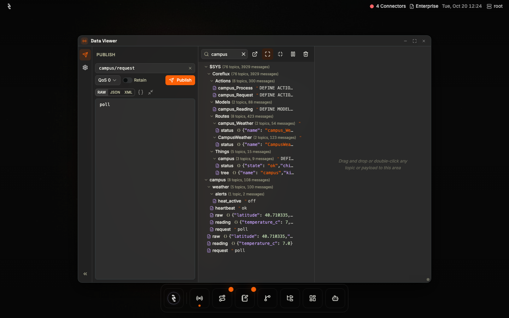
   *Publish `poll` to `campus/request`: the Thing's own `campus/raw` and `campus/reading` topics fill in.*

### Two helpful LoT tips when writing your own code

- **Use `"on"` / `"off"` strings instead of `"true"` / `"false"`:** LoT can interpret the text `"false"` as a boolean literal, which causes string comparisons to fail.
- **Keep division math simple:** Instead of `{a} / ({b} * {c})`, divide in two steps (`SET "x" WITH ({a} / {b})` followed by `({x} / {c})`) because LoT evaluates arithmetic left-to-right.

---

## 8. Troubleshooting & FAQ

### Setup & Docker

- **`docker compose up` fails with `"port is already allocated"`**  
  Another app on your machine is using port `1883`, `3000`, `8025`, or `9100`. Open `project/docker-compose.yml` and change the left-hand port number (for example, `"3001:3000"`), then run `docker compose up -d` again.
- **The HUB cannot connect to the broker**  
  In the HUB connection dialog, make sure the host is **`broker`** (not `localhost`), port **`1883`**, protocol **`mqtt://`**, username **`root`**, password **`coreflux`. (The HUB runs inside Docker, so it reaches the broker container by its Docker service name `broker`.)
- **How do I reset everything and start over from scratch?**  
  In the `project/` folder, run:
  ```bash
  docker compose down -v
  docker compose up -d
  docker compose wait load-project
  ```
  *(Note: `down -v` wipes the broker volume, including any activated licence.)*

### Weather API & Data Viewer

- **Nothing appears on `campus/weather/raw` after publishing `poll`**  
  1. Check **Broker Settings → Variables & Secrets** (or run `-listEnv` in Command Console) to verify `WEATHER_LAT` and `WEATHER_LON` are set.
  2. Confirm your laptop has internet access so the broker container can reach `api.open-meteo.com`.
- **Messages appear on `campus/weather/errors` instead of `reading`**  
  Click `campus/weather/errors` in Data Viewer to read the API response. If it says *"The service is overloaded"* (HTTP 503), Open-Meteo is rate-limiting requests (common when a whole room polls at once). Wait a minute and publish `poll` once.
- **`-setEnv` says *Invalid format***  
  Make sure there are no spaces around `=` (write `-setEnv WEATHER_LAT=40.7128`, not `-setEnv WEATHER_LAT 40.7128`).
- **The topic in the Publish box changed by itself!**  
  In Data Viewer, clicking any topic in the topic tree automatically copies that topic name into the Publish box. Always glance at the **Topic** field right before clicking **Publish**.

### Email & CSV History (Lab 4)

- **No email arrives in Mailpit (`http://localhost:8025`)**  
  1. An email is only sent when `heat_active` transitions from **`off` → `on`**. If `heat_active` was already `on`, set `config/heat_limit_c` to `30` (Retain on), publish `poll` (so `heat_active` becomes `off`), then set `config/heat_limit_c` to `1` (Retain on) and publish `poll` again.
  2. Check that `SMTP_HOST=mailpit`, `SMTP_USER=weather@example.com`, and secret `SMTP_PASSWORD` are set in **Broker Settings → Variables & Secrets**.
- **The email body in Mailpit is raw JSON instead of formatted HTML**  
  The broker could not find `/templates/heat-alert.html`. Make sure you ran `docker compose up -d` from inside the `project/` folder so `./templates` is mounted.
- **No `campus-weather.csv` file in `project/exports/`**  
  The file is created on the first reading after `WeatherHistory` is deployed. Trigger a `poll`. On Linux, if permissions block container writes, run `chmod 777 project/exports`.
- **`WeatherHistory` (or `3 Connectors` in the status bar) shows a red dot**  
  That is completely normal for `FILE_STORAGE` Connectors — they do not hold a persistent network socket open. Check `project/exports/campus-weather.csv` to confirm rows are being written.
- **Timestamps in the CSV have extra quotes (`"""2026-10-20 08:15:00"""`)**  
  This is a known broker quirk; spreadsheet apps still read the column as text.

### Licensing & Lab 5

- **Deploying the Rule in Lab 5 fails with *`require a Growth or Enterprise license`***  
  Your broker is running on Community Edition. Activate the event licence code in **Broker Settings → License → Activation code** (or `-activateLicense <code>` in Command Console), or treat Lab 5 as a read-along.
- **Adding a 4th Connector fails on Community Edition**  
  Community Edition supports up to 3 Connectors (which Labs 3 and 4 use). Either activate the event licence or remove an existing Connector first (`-removeConnector <Name>` in Command Console).

### Panels (Lab 6)

- **The panel cell shows a warning about indentation**  
  Make sure every `WITH` line is indented by 4 spaces under `DEFINE PANEL`.
- **Every card on the panel displays the same number**  
  Each component needs `WITH JSON_PATH "<field_name>"` at the end of its `BIND VALUE TO TOPIC` line so it extracts its specific field from the JSON reading.
- **The panel cards show `---`**  
  The panel is waiting for a new message on `campus/weather/reading`. Publish `poll` to `campus/weather/request`.

### Harmless things you can safely ignore

- The *What's New* pop-up or onboarding tour when opening a HUB window for the first time (click **Skip**).
- Demo topics like `dt` or `spBv1.0` in a fresh broker's topic tree.
- Escaped quotes (`\u0027`) in Command Console JSON replies.
- An *API key required* watermark on the mini-map preview that Data Viewer shows when it detects latitude/longitude fields.
- Long decimal places on `wind_mph`.
- An empty default `notebook.lotnb` file in the project tree.

---

## 9. Optional: Using VS Code instead of the HUB

The Coreflux HUB in your browser has everything you need for the workshop. However, if you prefer working in **VS Code**, this repository includes the **LoT Notebooks v1.0.0** extension (`vscode/vscode-lot-notebooks-1.0.0.vsix`).

1. Start the Docker stack first ([Step 1](#3-step-1-start-the-local-environment)).
2. Install the extension in VS Code:
   - Open the **Extensions** view (`Cmd+Shift+X` on macOS, `Ctrl+Shift+X` on Windows/Linux).
   - Click the **`…`** menu at the top right of the Extensions panel → **Install from VSIX…** and select `vscode/vscode-lot-notebooks-1.0.0.vsix`.
   - *(Or run `code --install-extension vscode/vscode-lot-notebooks-1.0.0.vsix` from the repository root.)*
3. Open your local `weather-station-hackathon` folder in VS Code, open `project/01-heartbeat.lotnb`, and connect to `localhost:1883` as `root` / `coreflux` ([VS Code guide](https://docs.coreflux.org/latest/quick-start/vscode)).

See [`vscode/README.md`](vscode/README.md) for full details and extension development instructions.

---

## 10. Further reading

- **LoT Actions:** [Action syntax](https://docs.coreflux.org/latest/lot-language/actions/syntax) · [Operations (`GET JSON`, `EMPTY`)](https://docs.coreflux.org/latest/lot-language/actions/operations)
- **LoT Models:** [MODEL publishing](https://docs.coreflux.org/latest/lot-language/models/publish-model)
- **LoT Connectors:** [REST API](https://docs.coreflux.org/latest/lot-language/routes/rest-api-routes) · [File storage](https://docs.coreflux.org/latest/lot-language/routes/data-storage/file-storage) · [Email](https://docs.coreflux.org/latest/lot-language/routes/notifications/email)
- **LoT Rules:** [Rule syntax](https://docs.coreflux.org/latest/lot-language/rules/syntax) · [RBAC](https://docs.coreflux.org/latest/lot-language/rules/rbac)
- **LoT Panels:** [Defining panels](https://docs.coreflux.org/latest/lot-language/panels/defining-panels) · [Data binding](https://docs.coreflux.org/latest/lot-language/panels/data-binding)
- **Broker & HUB:** [Secrets and environment variables](https://docs.coreflux.org/latest/mqtt-broker/secrets-and-env) · [Broker commands](https://docs.coreflux.org/latest/mqtt-broker/commands) · [Using the HUB](https://docs.coreflux.org/latest/quick-start/using-hub) · [LoT Editor](https://docs.coreflux.org/hub/lot-editor)
