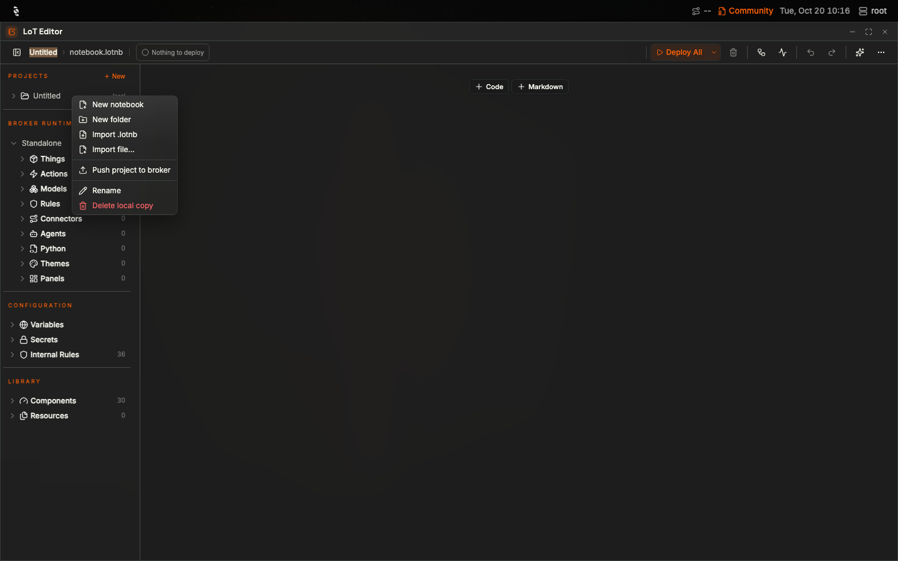
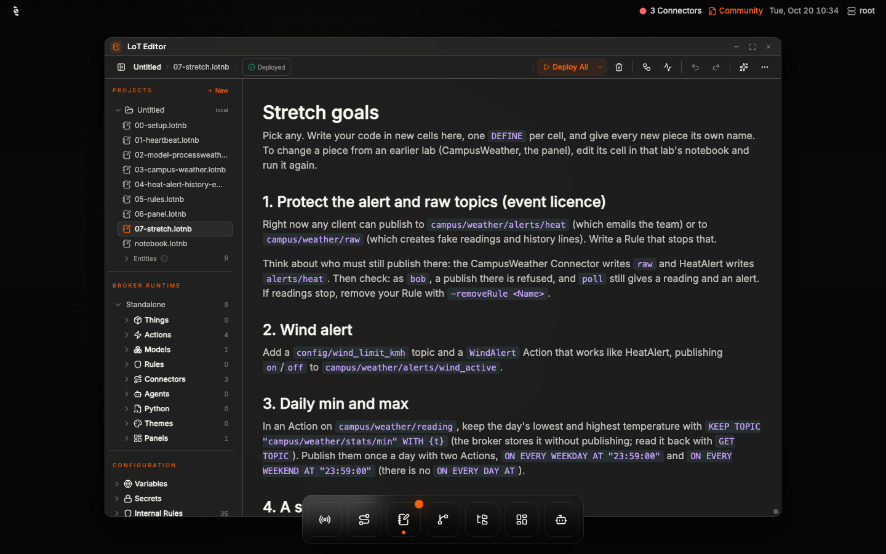

# Hackathon: build a live weather station with LoT

You will build a weather station that runs entirely inside one Coreflux Broker. It asks a
weather API for your site, converts the units, raises a heat alert, keeps a CSV history,
emails the team once per heat episode and shows a live dashboard.

**Time:** about 2 hours for the core labs, plus stretch goals.
**Software:** Coreflux Broker 2.22 or later and HUB 2.12 or later, both started by
`project/docker-compose.yml`. Everything runs on your laptop with Docker. See [Prerequisites](#prerequisites).

## Prerequisites

About **2 hours** for the core labs (labs 1 to 6). Stretch goals are extra.

You need:

- **Docker** and **Docker Compose** (how to get them is below)
- a **web browser** (the HUB is at http://localhost:3000)
- **internet** the first time you start, so Docker can download the images, and later so the broker
  can call the weather API

**Coreflux Broker 2.22 or later** and **HUB 2.12 or later** are not installed by hand. Both are
started by `project/docker-compose.yml`, together with Mailpit (a test inbox).

### Install Docker and Docker Compose

Docker runs the broker, the HUB and Mailpit as containers. Docker Compose starts all three with one
command. The lesson uses Compose v2: `docker compose` (a space), not the older `docker-compose`.

Check what you already have. In a terminal:

```bash
docker --version
docker compose version
```

Both commands should print a version. `docker compose version` should say `Docker Compose version v2…`.

| System | How to install |
|---|---|
| Windows | [Docker Desktop for Windows](https://docs.docker.com/desktop/setup/install/windows-install/). It includes Docker Compose. Start Docker Desktop and wait until it says it is running. |
| macOS | [Docker Desktop for Mac](https://docs.docker.com/desktop/setup/install/mac-install/) (Apple silicon or Intel). It includes Docker Compose. Start Docker Desktop and wait until it says it is running. |
| Linux | [Docker Engine](https://docs.docker.com/engine/install/) and the [Docker Compose plugin](https://docs.docker.com/compose/install/linux/). |

The overview of every platform is [Get Docker](https://docs.docker.com/get-started/get-docker/).

If a check fails:

- **`docker: command not found`.** Docker is not installed, or this terminal was opened before the
  install finished. Install from the table above, then open a new terminal.
- **`Cannot connect to the Docker daemon`.** Start Docker Desktop (Windows and macOS) or the Docker
  service (Linux), then run the check again.
- **`docker compose` is not a command, but `docker-compose` is.** That is Compose v1. Update Docker
  Desktop, or on Linux install the Compose plugin. The lesson's commands are `docker compose`.

## What "done" looks like

- `campus/weather/heartbeat` ticks every 5 seconds.
- Publishing `poll` to `campus/weather/request` produces a reading on `campus/weather/reading`.
- `project/exports/campus-weather.csv` gains a line per reading.
- Lowering `config/heat_limit_c` below the current temperature turns `heat_active` to `on`, puts
  one message on `campus/weather/alerts/heat` and one email in Mailpit (http://localhost:8025).
- The Campus Weather panel shows °C, °F, wind and the heat state.

## Words you will meet

| Word | Meaning |
|---|---|
| Topic | The "address" of an MQTT message, like `campus/weather/reading`. |
| Retained | The broker keeps the last message on a topic and gives it to anyone who subscribes later. |
| Action | "When X happens, do Y" (`DEFINE ACTION`). |
| Model | The shape of a message, field by field (`DEFINE MODEL`). |
| Connector | A link to the outside world: a web API, a file, an email server (`DEFINE CONNECTOR`). |
| Rule | Who may publish or subscribe where (`DEFINE RULE`). |
| Panel | A dashboard screen in the HUB (`DEFINE PANEL`). |
| HUB | The web app at http://localhost:3000 where you write, deploy and watch everything. |

## Get the lesson

The lesson is on GitHub: https://github.com/CorefluxCommunity/weather-station-hackathon. Everything you run is in the `project/` folder: the eight lab
notebooks (`00-setup` … `07-stretch`), `docker-compose.yml` (Broker, HUB and Mailpit), the email
template and the `exports/` folder.

1. **Get a local copy, so you can start Docker**, one of:
   - `git clone https://github.com/CorefluxCommunity/weather-station-hackathon.git`
   - on the GitHub page, **Code → Download ZIP**, then unzip it.
2. **Start it:** `cd weather-station-hackathon/project` (`weather-station-hackathon-main/project`
   for the ZIP) and `docker compose up -d`.
3. **Open it in the HUB.** The HUB clones straight from GitHub. You do not import the notebooks.
   Open http://localhost:3000, click **Connect**, then **LoT Editor** from the dock. **New → From git…**,
   paste `https://github.com/CorefluxCommunity/weather-station-hackathon.git` and click **Clone**.
   The repository lands in the tree, notebooks and `index.html` included. Click `index.html` for the
   platform overview (see below). Open `project/01-heartbeat` and click ▷ on its cell (Run Cell), or
   **Deploy All**. Do not use **Push project to broker**: every lab is deployed cell by cell.
   **VS Code** is the other editor: Command Palette → **Git: Clone**, paste the same URL, pick a
   folder and click **Open**. Install the **LoT Notebooks** extension
   ([guide](https://docs.coreflux.org/latest/quick-start/vscode)), connect it to `localhost:1883`
   as `root` / `coreflux`, and open `project/01-heartbeat.lotnb`.


*Import is only for a copy that was not cloned. In the HUB, **New → From git…** clones the GitHub repository.*


*The eight notebooks from `project/`, imported. `notebook.lotnb` is the project's empty default.*


*Click ▷ on the cell: *Action 'Heartbeat' added successfully*.*


*Data Viewer: `campus/weather/heartbeat` shows `ok`.*

## Platform overview

After you clone the lesson into the HUB (**LoT Editor → New → From git…**), click `index.html` in
the project tree. The slides open in the editor, and the buttons and arrow keys work there. Full
screen is at the top right of the page.

If you have the files on your laptop, you can also open [index.html](index.html) in a browser. Same
slides. This is the map of the station: what you will build, then each Coreflux piece the labs use.

| Slide | Piece | What it is for in this lesson |
|---|---|---|
| The finished weather station | The result | A live dashboard fed by one Broker |
| What Coreflux brings | Get, hold, work, send | How a reading moves from the weather API to the dashboard, the file and the email |
| The Broker | Broker | The base everything else sticks to. The HUB is the window onto it |
| Topics | Topics | Addresses such as `campus/weather/reading` |
| Actions | Actions | "When X happens, do Y" |
| Connectors | Connectors | The weather API, the CSV file and the email |
| Models | Models | The shape of a reading, field by field |
| Rules | Rules | Who may change the heat limit |
| Panels | Panels | The Campus Weather dashboard |
| Put together | Recap | The same pieces, in the order the labs deploy them |
| One Thing | `DEFINE THING` | Optional. The stretch goal in `07-stretch` |

The core labs that follow are about **2 hours**.

## Before you start

Clone the lesson into the HUB and open `index.html` there (the [platform overview](#platform-overview)),
then follow `project/README.md` sections 1 to 3:

1. `docker compose up -d` in the `project` folder, open http://localhost:3000 and click **Connect**
   (the form is already filled in: `root` / `coreflux`).
2. The GitHub clone already has the notebooks. Follow `00-setup`: four variables and a secret in **Command Console**
   (click `root` at the top right), then publish `30`, retained, to `config/heat_limit_c`.

**Finding your way in the HUB:** the dock at the bottom opens **Data Viewer**, **Connectors**,
**LoT Editor** and **Dashboards** (hover an icon for its name). Your user name (`root`) at the top
right opens **Command Console**, **Broker Settings** and **Log out**. The licence is shown next to it.

Lab 5 (Rules) needs the event trial licence: the organisers give you a code (one seat per broker),
and you activate it in **Broker Settings → License → Activation code** or with `-activateLicense <code>`
(README section 2). Without it your broker is Community Edition, which
covers every other lab; then Lab 5 is a read-along.

## The labs

Open **LoT Editor** from the dock. After **New → From git…**, the eight notebooks are already in
the tree under `project/`. There is one notebook per lab. Each starts with what you will build, has its cells in run order (one piece per
cell) and ends with *Check it worked*. Run a notebook with **Deploy All** (top right), or one cell with
▷ at its top left. Check each lab in **Data Viewer**, where you can also **Publish**.

| Lab | Time | Notebook | You build | Check |
|---|---|---|---|---|
| 1 | 10 min | `01-heartbeat` | Your first Action | `campus/weather/heartbeat` shows `ok` every 5 s |
| 2 | 25 min | `02-model-processweather` | The WeatherReading Model and the unit conversion | Publish the sample answer below to `campus/weather/raw`: a reading with `temperature_f` 65.12 appears on `campus/weather/reading` |
| 3 | 25 min | `03-campus-weather` | The web API Connector and the 5-minute poll | Publish `poll` to `campus/weather/request`: real weather arrives on `raw`, then a reading |
| 4 | 25 min | `04-heat-alert-history-email` | Alert, history, email | Publish `1` (retained) to `config/heat_limit_c` and `poll`: `heat_active` = `on`, one message on `alerts/heat`, one email in Mailpit, a line in `project/exports/campus-weather.csv`. Then set the limit back to `30`; `heat_active` turns `off` at the next reading |
| 5 | 15 min | `05-rules` (event licence) | Protect the heat limit | As `bob` (not in `operators`), publishing to `config/heat_limit_c` does not change it; as `alice` it does. On Community: read along, the Rule is refused |
| 6 | 20 min | `06-panel` | The Campus Weather panel | **Dashboards** (dock) lists *Campus Weather*; it updates on every `poll` |

Labs 1 to 6 are about **2 hours**.

Deploy the labs in order: later labs use pieces from earlier ones and never define them again.

Sample answer for Lab 2 (what Open-Meteo returns, trimmed):

```json
{"current": {"temperature_2m": 18.4, "wind_speed_10m": 12.6}}
```

`RequestWeather` polls by itself every 5 minutes, but the first automatic poll comes 5 minutes
after you deploy it. Publish `poll` yourself to test.

## Step by step, with screenshots

Screenshots of every step, taken on a fresh laptop setup. Labs 1 to 4 and 6 show Community Edition; Lab 5 and the Thing stretch goal show a licensed broker. Click to open each lab.

<details><summary>Before you start</summary>


*1. Open http://localhost:3000. The form is already filled in: click **Connect**.*


*2. A short tour opens: click **Skip**.*


*3. The HUB. The dock at the bottom opens the tools; `root` at the top right opens the account menu.*


*The licence (*Community*, or the edition of your licence once it is active) is shown next to your user name.*


*Click `root` for Command Console, Broker Settings and Log out.*


*4. A GitHub clone (**New → From git…**) already puts the notebooks in the tree. Import is only if you did not clone.*


*5. The eight notebooks in the project tree.*


*6. Open `00-setup` and follow it.*


*7. Command Console: each command answers `"success":true`. (The secret line is hidden here.)*


*8. Broker Settings → Variables & Secrets → Variables: the four variables.*


*9. Secrets: `SMTP_PASSWORD`, value hidden.*


*10. Data Viewer → Publish: `30` to `config/heat_limit_c`, **Retain** on.*

</details>

<details><summary>Lab 1: Heartbeat</summary>


*Open `01-heartbeat`.*


*Click ▷ on the cell (or **Deploy All**): the cell shows it is deployed.*


*Data Viewer: `campus/weather/heartbeat` shows `ok`.*

</details>

<details><summary>Lab 2: Model and ProcessWeather</summary>


*Deploy `02-model-processweather`.*


*Publish the sample answer to `campus/weather/raw`: the reading has `temperature_f` 65.12.*

</details>

<details><summary>Lab 3: CampusWeather</summary>


*Deploy `03-campus-weather`.*


*Publish `poll` to `campus/weather/request`: real weather on `raw`, then a reading.*

</details>

<details><summary>Lab 4: Alert, history, email</summary>


*Deploy `04-heat-alert-history-email`.*


*Limit `1` and `poll`: `heat_active` is `on` and one message is on `alerts/heat`.*


*Mailpit (http://localhost:8025): one email.*


*The email, from the HTML template.*


*`project/exports/campus-weather.csv` gains a line per reading.*


*Connectors window: WeatherHistory shows red. That is normal for file Connectors; check the CSV.*

</details>

<details><summary>Lab 5: Rules</summary>


*Broker Settings → License: paste the event licence code (`CFLX-…`) in **Activation code** and click **Activate**.*


*With a licence active the tab shows the tier, and **RBAC / Topic ACL** is ticked under Features. (Licence details hidden here.)*


*The top right now shows the licence instead of *Community*.*


*Command Console: the two users and the `operators` group. (Passwords hidden here.)*


*Run the Rule cell with ▷: *Rule 'ProtectWeatherConfig' added successfully!**


*Read-along: without a licence the Rule is refused.*


*Log out, ⚙ next to *Weather station* → **Add user**: `bob`, tick **Default**, **Connect**.*


*As bob the HUB shows *No SYS* and fewer dock icons: normal.*


*bob publishes `5` to `config/heat_limit_c`. The HUB says *Sent (delivery unconfirmed)*: the broker drops it without an error.*


*Log out, pick `root` in the user chip, **Connect**.*


*As root, `config/heat_limit_c` still shows `30`: bob was refused. (Without the Rule it would show `5`.)*

</details>

<details><summary>Lab 6: Panel</summary>


*Deploy `06-panel`.*


*Dashboards (dock): *Campus Weather* is listed.*


*Open it and publish `poll`: °C, °F, wind and the heat state.*

</details>

## When something does not work

- **`docker compose up` fails with "port is already allocated":** change the left-hand port in
  `project/docker-compose.yml` (see README section 1).
- **The HUB cannot connect:** host `broker`, port `1883`, protocol `mqtt://`, user `root`,
  password `coreflux`. Not `localhost`.
- **Nothing on `raw` after a poll:** check **Broker Settings → Variables & Secrets** (or `-listEnv`) for
  `WEATHER_LAT`/`WEATHER_LON`; check the broker has internet access.
- **Messages on `campus/weather/errors`:** the weather API answered with an error; read the
  payload. *"The service is overloaded"* (HTTP 503) means Open-Meteo is busy, or the whole room is
  polling it at once: wait a minute and poll again. Don't poll in a loop.
- **No email:** check `campus/weather/alerts/heat` first; an email goes out only when the state
  turns from `off` to `on`. Set the limit to `30`, poll (state `off`), then set it to `1` and poll.
  Check `SMTP_HOST=mailpit` with `-listEnv`.
- **The email body is raw JSON:** the broker cannot find `/templates/heat-alert.html`. Run
  `docker compose up -d` from the `project` folder so `templates/` is mounted.
- **No CSV file:** it appears after the first reading. Run `docker compose up -d` from the
  `project` folder so `exports/` is mounted. On Linux, make the folder writable:
  `chmod 777 project/exports`.
- **WeatherHistory shows red / disconnected in the Connectors window:** normal for file Connectors
  today. Check the CSV file.
- **Timestamps in the CSV look like `"""2026-10-20 08:15:00"""`:** a known broker issue. The value
  is right; spreadsheets read it as text.
- **`-setEnv` says *Invalid format*:** use `NAME=value`, no spaces.
- **The Rule is refused with *require a Growth or Enterprise license*:** your broker is on Community
  Edition. Activate the event licence (**Broker Settings → License**, or `-activateLicense <code>`; README
  section 2) and run the cell again, or follow Lab 5 as a read-along.
- **`-activateLicense` is refused:** check the code and that the broker has internet access. If it
  says no seat is free, tell the organisers.
- **A 4th Connector is refused:** Community Edition allows 3, and the lesson uses all 3. Remove one
  (`-removeConnector <Name>`) or use the event licence.
- **The panel shows a warning about indentation:** indent every `WITH` line of the panel 4 spaces
  under `DEFINE PANEL`.
- **Every box of the panel shows the same value:** put the field on the `BIND` line,
  `BIND VALUE TO TOPIC "campus/weather/reading" WITH JSON_PATH "temperature_f"`.
- **The panel shows `---`:** it fills in with the next reading. Publish `poll`.
- **Deploy All says *Stopped at cell 1 of 1* in `05-rules`:** the Rule was refused on Community
  Edition. See the licence item above.
- **A red dot and *3 Connectors* at the top:** that is WeatherHistory (see above); the other two are fine.
- **The topic in the Publish box changed by itself:** clicking a topic in the tree copies it into the
  Publish box. Check the topic before you click **Publish**.
- **Things you can ignore:** the *What's New* pop-up, the short tour the first time you open a window
  (**Skip**), the `dt` and `spBv1.0` demo topics in a new broker, the `\u0027` marks in Command Console
  answers, the *API key required* mark on the map that Data Viewer draws for lat/lon, the long decimals
  in `wind_mph`, and the empty `notebook.lotnb` in the project.
- **As `bob` the HUB shows *No SYS* and fewer dock icons:** normal for a user who is not an admin.

## Stretch goals

The hints are in `project/07-stretch.lotnb`; write your code in new cells there.

1. Protect the alert and raw topics with a Rule (event licence).
2. A wind alert, like HeatAlert.
3. Daily min and max, published once a day.
4. A second site on CampusWeather.
5. More on the panel: wind in mph and the time of the last reading.
6. One Thing per site with `DEFINE THING TEMPLATE`.

<details><summary>Stretch goal 6: the Thing, with a licence</summary>


*A new cell in `07-stretch` with the template and `DEFINE THING campus OF WeatherStation`, run with ▷: *Applied Things 'WeatherStation', 'campus'*. Its Connector is the 4th, so on Community Edition remove one first.*


*Publish `poll` to `campus/request`: the Thing's own `campus/raw` and `campus/reading` appear.*

</details>

Two LoT quirks to know when you write your own code:

- Compare against `"on"`/`"off"`, not the text `"true"`/`"false"`: LoT treats `"false"` as a boolean
  and the Action fails.
- Don't put a product in parentheses after a division, like `{a} / ({b} * {c})`: it is worked out
  left to right. Divide in two steps instead: `SET "x" WITH ({a} / {b})`, then `({x} / {c})`.

## Docs

- [Action syntax](https://docs.coreflux.org/latest/lot-language/actions/syntax) ·
  [Operations](https://docs.coreflux.org/latest/lot-language/actions/operations)
- [MODEL publishing](https://docs.coreflux.org/latest/lot-language/models/publish-model)
- [REST API connectors](https://docs.coreflux.org/latest/lot-language/routes/rest-api-routes) ·
  [File storage](https://docs.coreflux.org/latest/lot-language/routes/data-storage/file-storage) ·
  [Email](https://docs.coreflux.org/latest/lot-language/routes/notifications/email)
- [Rule syntax](https://docs.coreflux.org/latest/lot-language/rules/syntax) ·
  [RBAC](https://docs.coreflux.org/latest/lot-language/rules/rbac)
- [Defining panels](https://docs.coreflux.org/latest/lot-language/panels/defining-panels) ·
  [Data binding](https://docs.coreflux.org/latest/lot-language/panels/data-binding)
- [Secrets and environment variables](https://docs.coreflux.org/latest/mqtt-broker/secrets-and-env) ·
  [Broker commands](https://docs.coreflux.org/latest/mqtt-broker/commands)
- [Using the HUB](https://docs.coreflux.org/latest/quick-start/using-hub) ·
  [LoT Editor](https://docs.coreflux.org/hub/lot-editor) ·
  [VS Code](https://docs.coreflux.org/latest/quick-start/vscode)
