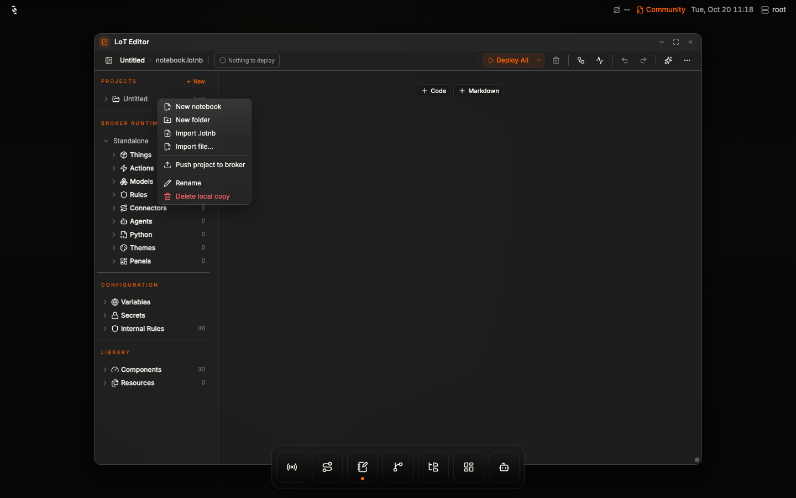
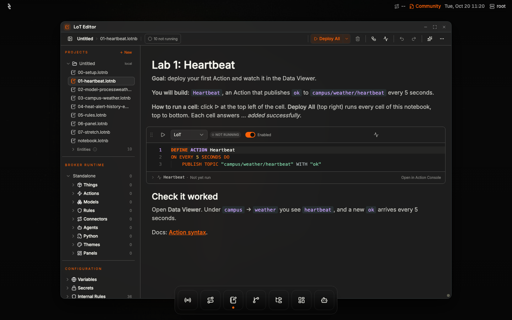
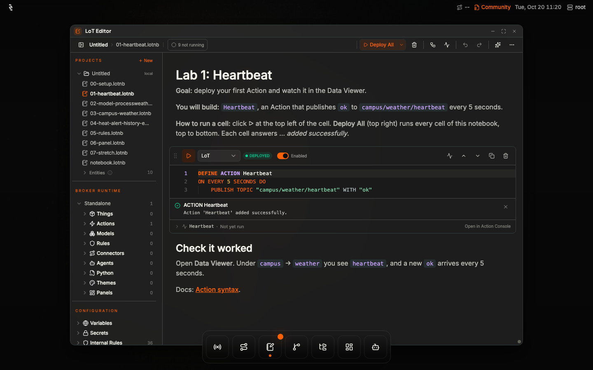
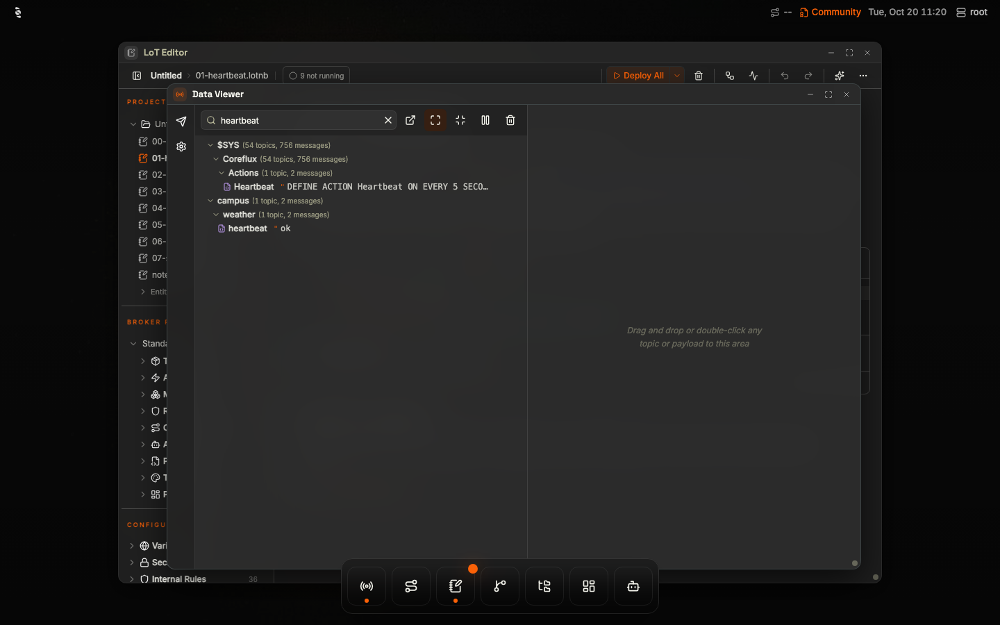

# Campus weather station: setup and reference

Participants start with [`../HACKATHON.md`](../HACKATHON.md). This file has the setup steps
and the details the labs point to.

**Versions:** Coreflux Broker 2.22 or later and HUB 2.12 or later; `docker-compose.yml` starts both.
The notebooks use `DEFINE CONNECTOR`, which Broker 2.14 and earlier do not have. About **2 hours**
for the core labs.

Install Docker and Docker Compose before section 1. The steps are in
[Prerequisites](../HACKATHON.md#prerequisites) (`docker` and `docker compose version` should both
print a version).

Before the labs, open the platform overview in a browser: [`../index.html`](../index.html). The
slide list is in [Platform overview](../HACKATHON.md#platform-overview).

## 0. Get the lesson

The lesson is on GitHub: https://github.com/CorefluxCommunity/weather-station-hackathon. Everything you run is in the `project/` folder: the eight lab
notebooks (`00-setup` … `07-stretch`), `docker-compose.yml` (Broker, HUB and Mailpit), the email
template and the `exports/` folder.

1. **Download it**, one of:
   - `git clone https://github.com/CorefluxCommunity/weather-station-hackathon.git`
   - on the GitHub page, **Code → Download ZIP**, then unzip it.
2. **Start it:** `cd weather-station-hackathon/project` (`weather-station-hackathon-main/project`
   for the ZIP) and `docker compose up -d`.
3. **Open the notebooks**, one of:
   - **HUB** (http://localhost:3000): the LoT Editor has no clone-from-git command, so import the
     files from your copy. Open **LoT Editor** from the dock, right-click the project (*Untitled*) →
     **Import .lotnb**, and pick the notebooks in `project/` one at a time (or drag them onto the
     tree). Open `01-heartbeat` and click ▷ on its cell (Run Cell), or **Deploy All**. Do not use
     **Push project to broker**: every lab is deployed cell by cell.
   - **VS Code:** Command Palette → **Git: Clone**, paste `https://github.com/CorefluxCommunity/weather-station-hackathon.git`, pick a folder and click
     **Open**. Install the **LoT Notebooks** extension
     ([guide](https://docs.coreflux.org/latest/quick-start/vscode)), connect it to `localhost:1883`
     as `root` / `coreflux`, open `project/01-heartbeat.lotnb` and run its cell.


*Right-click *Untitled*: **Import .lotnb** (there is no clone-from-git command).*


*The eight notebooks from `project/`, imported. `notebook.lotnb` is the project's empty default.*


*Click ▷ on the cell: *Action 'Heartbeat' added successfully*.*


*Data Viewer: `campus/weather/heartbeat` shows `ok`.*

## 1. Start the broker, the HUB and Mailpit

You need Docker with Docker Compose (see [Prerequisites](../HACKATHON.md#prerequisites)) and internet
access (the broker calls `api.open-meteo.com`). In this `project` folder:

```
docker compose up -d
```

> **Organisers:** before the event, replace the placeholders `GA_BROKER_TAG` and `GA_HUB_TAG` in
> `docker-compose.yml` with the GA release tags, and check that `docker compose pull` works.

| What | Where |
|---|---|
| HUB | http://localhost:3000 |
| Mailpit (test inbox) | http://localhost:8025 |
| Broker MQTT, for VS Code and `mosquitto_pub` | `localhost:1883`, user `root`, password `coreflux` |
| Broker health | http://localhost:9100/health |

Open the HUB. The connection form is already filled in (*Weather station*, `mqtt://broker:1883`,
user `root`, password `coreflux`): click **Connect**. (The host is `broker`, not `localhost`: the HUB
reaches the broker from inside Docker.) A short HUB tour opens; click **Skip** or follow it.

**Finding your way in the HUB:** the dock at the bottom opens **Data Viewer**, **Connectors**,
**LoT Editor** and **Dashboards** (hover an icon to see its name). Click your user name (`root`) at the
top right for **Command Console**, **Broker Settings** and logging out. The licence (*Community* on a
fresh broker) is shown next to it.

Ports 1883, 3000, 8025 or 9100 already in use on your machine? Change the left-hand number in
`docker-compose.yml` (for example `"3001:3000"`) and use that port instead.

To start the labs from zero again: `docker compose down -v`, then `docker compose up -d`.

## 2. Licence

A fresh broker runs as **Community Edition**. That covers every lab except Lab 5 (Rules).

| Notebook | Community | Event licence (trial / Growth / Enterprise) |
|---|---|---|
| 00–02, 06, 07 | yes | yes |
| 03, 04 (3 Connectors in all) | yes, they use all 3 allowed Connectors | yes |
| 05 (Rule) | read-along only: the broker refuses your own Rules | yes |

**Event licence:** the organisers give you an activation code (`CFLX-…`). Open **Broker Settings**
(click `root` at the top right) → **License** → **Activation code**, paste it and click **Activate**.
Or send it in **Command Console**:

```
-activateLicense CFLX-your-code
```

The answer names the plan you got, and the licence at the top right of the HUB changes from
*Community*. The broker needs internet access for this. Each broker that activates uses one seat of the
event licence, so activate once and keep your broker: `docker compose down -v` wipes the licence with
the rest of the data, and activating again may use another seat. (Organisers: ask for a licence with
one seat per laptop plus a few spare; you can also put the code in `COREFLUX_ACTIVATION_CODE` in
`docker-compose.yml` before the first `docker compose up`.)

The licence in use is shown at the top right of the HUB, in **Broker Settings → License**, and at
http://localhost:9100/license (`"tier"`).

## 3. Set the variables

These steps are also in `00-setup.lotnb`. In the HUB, open **Command Console** (click `root` at the
top right) and send these lines one at a time:

```
-setEnv WEATHER_LAT=40.7128
-setEnv WEATHER_LON=-74.0060
-setEnv SMTP_HOST=mailpit
-setEnv SMTP_USER=weather@example.com
-setSecret SMTP_PASSWORD=any-password
```

Each one answers with a line of JSON containing `"success":true` and *… set successfully*. Check
in **Broker Settings → Variables & Secrets** (you can also add them there), or with `-listEnv` and
`-listSecrets`. A secret's value is never shown.

- `WEATHER_LAT` / `WEATHER_LON` are your site (the example is New York). The CampusWeather
  Connector puts them into the request as `{env.WEATHER_LAT}` and `{env.WEATHER_LON}`.
- Write `NAME=value` with no spaces around `=`. `-setEnv NAME value` is refused with
  *Invalid format. Use: NAME=value*.
- Mailpit accepts any user and password. For a real mailbox, use your provider's host, user and
  password, and change the HeatMail cell (`04-heat-alert-history-email`).
- A password containing `//` is cut there (`//` starts a comment). Choose one without it.

Docs: [Secrets and environment variables](https://docs.coreflux.org/latest/mqtt-broker/secrets-and-env).

**Heat limit:** in **Data Viewer**, open **Publish** (paper-plane icon on the left): topic `config/heat_limit_c`,
payload `30`, **Retain** switched on, then **Publish**. That is the heat limit in °C; while the topic is empty the alert stays off.

## 4. Deploy the notebooks

There is one notebook per lab, in order. Each notebook explains the lab, has its cells in run order
(one piece, one `DEFINE`, per cell) and ends with *Check it worked*.

| Notebook | Lab | Pieces |
|---|---|---|
| `00-setup` | Before you start | commands only: variables, secret, heat limit |
| `01-heartbeat` | 1 | Action Heartbeat |
| `02-model-processweather` | 2 | Model WeatherReading, Action ProcessWeather |
| `03-campus-weather` | 3 | Connector CampusWeather, Action RequestWeather |
| `04-heat-alert-history-email` | 4 | Action HeatAlert, Connectors WeatherHistory and HeatMail |
| `05-rules` | 5 (event licence) | Rule ProtectWeatherConfig |
| `06-panel` | 6 | Panel CampusWeather |
| `07-stretch` | stretch goals | hints only; add your own cells |

**HUB (main path):**

1. Open **LoT Editor** from the dock.
2. Right-click the project (*Untitled*) in the tree → **Import .lotnb**, once per notebook (or drag
   the files onto the tree).
3. Open a lab's notebook and click **Deploy All** (top right; it runs the notebook's cells top to
   bottom), or click ▷ at the top left of one cell. Each cell reports *… added successfully*.

Deploy one lab notebook at a time, in order: later labs use pieces from earlier ones. Keep the
deploy button on **Deploy All**; the lesson does not use its other mode, and does not use
**Push project to broker**.

**VS Code:** install the LoT Notebooks extension
([guide](https://docs.coreflux.org/latest/quick-start/vscode)), connect to `localhost:1883` as `root`,
open the notebooks and run each cell in order.

**MQTT commands** (any MQTT client, as `root`): publish the cell's text to `$SYS/Coreflux/Command`
after the matching command, and read the answer on `$SYS/Coreflux/Command/Output`:

| Cell starts with | Command |
|---|---|
| `DEFINE MODEL` | `-addModel` |
| `DEFINE ACTION` | `-addAction` |
| `DEFINE CONNECTOR` | `-addConnector` |
| `DEFINE RULE` | `-addRule` |
| `DEFINE PANEL` | `-addPanel` |

**Changing something:** edit the cell and run it again. Models, Actions, Connectors and Panels are
replaced in place. A Rule must be removed first (`-removeRule <Name>`); the HUB's ▷ does that for
you.

## 5. Files

- `templates/heat-alert.html` is the email body. The compose file mounts `templates/` at
  `/templates` in the broker. **If the file is missing, the email still goes out with the raw JSON
  reading as its body, and no error is shown.**
- `exports/campus-weather.csv` is the history the WeatherHistory Connector writes (`/data/exports` in
  the broker). It appears after the first reading.

## 6. Quick test (after all notebooks)

1. **Data Viewer:** `campus/weather/heartbeat` shows `ok` every 5 seconds.
2. Publish `poll` to `campus/weather/request`. Within a few seconds: the Open-Meteo answer on
   `campus/weather/raw`, a reading on `campus/weather/reading`, `off` on
   `campus/weather/alerts/heat_active`, and a new line in `exports/campus-weather.csv`.
3. Publish `1` (retained) to `config/heat_limit_c`, then `poll` again: `heat_active` turns `on`, one
   message arrives on `campus/weather/alerts/heat`, and one email *Campus heat alert* in Mailpit.
   Poll again: no second email (same heat episode).
4. Publish `30` (retained) to `config/heat_limit_c` to put the limit back. `heat_active` turns `off`
   at the next reading.
5. The **Campus Weather** panel (**Dashboards** in the dock) shows the latest °C, °F, wind and heat state.
